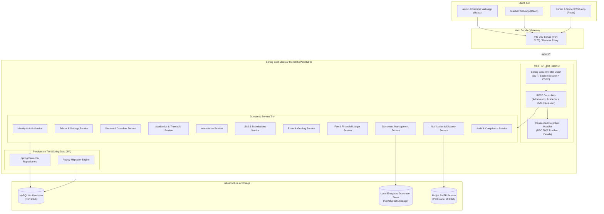

# Architecture Document — Bluebells School LMS & School Management Portal

## 1. Architectural Vision & Style: Modular Monolith

Bluebells School LMS & School Management Portal is designed as a **Modular Monolith**. This pattern delivers clean architectural separation of business concerns, strong domain encapsulation, simplified local deployment, transactional integrity across related domains, and minimal operational overhead—avoiding the distributed complexity, network latency, and operational cost of microservices for a single-institution school management system.

### Key Architectural Tenets
1. **Separation of Concerns**: Domain logic is partitioned into cohesive, well-defined modules.
2. **Strict Encapsulation & DTO Boundaries**: JPA entities never cross the web/REST boundary. All inputs and outputs utilize validated Data Transfer Objects (DTOs).
3. **Transactional Integrity**: Financial entries, academic progression, and attendance recording enforce atomic ACID transactions with optimistic concurrency controls (`@Version`).
4. **Zero-Cost & Free/Open-Source First**: Fully runnable on local workstations and commodity servers without proprietary cloud licenses or third-party paid APIs.
5. **Security in Depth**: Multi-layer authorization (Spring Security filter chain + `@PreAuthorize` method security + resource ownership checks).

---

## 2. System Architecture & Context



---

## 3. Technology Stack & Exact Versions

| Component | Technology | Version | Rationale |
|---|---|---|---|
| **Language** | Java (OpenJDK LTS) | 17.0.20+ / 21 LTS | Stable enterprise LTS baseline compatible with Spring Boot 3.3.x. |
| **Backend Framework** | Spring Boot | 3.3.5 | Modern stable release with Jakarta EE 10, Spring 6, and native observability. |
| **Build Tool** | Apache Maven | 3.9.16 (with `./mvnw`) | Standard reproducible build lifecycle. |
| **ORM / Persistence** | Spring Data JPA / Hibernate | 6.5.x (Jakarta Persistence 3.1) | Robust relational ORM with optimistic locking and criteria queries. |
| **Database Migrations** | Flyway | 10.x | Deterministic, version-controlled schema evolution. |
| **Security Framework** | Spring Security | 6.3.x | Comprehensive RBAC, authentication filters, password hashing (BCrypt strength 12 / Argon2). |
| **API Documentation** | Springdoc OpenAPI UI | 2.6.0 | Swagger UI and OpenAPI 3.0 specification auto-generation. |
| **Frontend Framework** | React with TypeScript | React 18.3.x / TS 5.5.x | Strictly typed, reactive single-page application. |
| **Frontend Bundler** | Vite | 5.4.x | Fast HMR, optimized production tree-shaking. |
| **Server State / Cache**| TanStack Query (React Query) | 5.x | Automatic caching, stale-while-revalidate, request deduplication. |
| **Form Handling** | React Hook Form + Zod | 7.x / Zod 3.x | Type-safe, declarative schema validation matching backend bean constraints. |
| **Styling & UI** | Tailwind CSS + Lucide Icons | Tailwind 3.4.x | Accessible, modern, cohesive responsive design system. |
| **Primary Database** | MySQL | 8.0+ / 8.4 LTS | Native ACID relational storage with transactional InnoDB engine. |
| **Secondary Target** | IBM Db2 compatibility | Profile `db2` | Dialect abstraction via Hibernate Db2Dialect and portable ANSI SQL migrations. |

---

## 4. Module Boundaries & Responsibilities

The backend is partitioned into explicit functional modules under `com.bluebells`:

```
backend/src/main/java/com/bluebells/
├── common/             # Base entities (AuditableEntity), pagination DTOs, utilities, constants
├── config/             # Spring configuration (Security, WebMvc, Auditing, OpenAPI, Storage)
├── exception/          # GlobalExceptionHandler, ApiException, ResourceNotFoundException, ProblemDetails
├── security/           # JWT/Session authentication, UserPrincipal, Method Security, RateLimiter
├── audit/              # AuditLog entity, AuditEventListener, Revision tracking
├── identity/           # User, Role, Permission entities, UserManagementService
├── school/             # SchoolProfile, AcademicSession, Term, Settings
├── academics/          # GradeLevel, ClassEntity, Section, Subject, Timetable, Curriculum
├── admissions/         # AdmissionInquiry, Application, Registration, WorkflowEngine
├── students/           # Student, StudentProfile, EnrollmentHistory, PromotionService
├── guardians/          # Guardian, GuardianStudentLink, EmergencyContacts
├── staff/              # StaffProfile, TeacherAssignment, Department
├── attendance/         # StudentAttendance, AttendanceCorrection, MonthlySummaries
├── lms/                # Course, Lesson, Resource, Assignment, Submission, Feedback
├── examinations/       # Exam, ExamSchedule, MarksEntry, GradingScale, ReportCardService
├── fees/               # FeeStructure, FeeCategory, Invoice, Payment, Allocation, Receipt
├── notifications/      # Notification, InAppNotificationService, EmailDispatcher (Mailpit)
├── documents/          # DocumentMetadata, SecureStorageService, FileTypeValidator
└── analytics/          # ReportingQueries, DashboardAggregator, PerformanceMetrics
```

---

## 5. IBM Db2 Compatibility Assessment

### Diagnostic Findings
- **Production Target**: MySQL 8.x (InnoDB, UTF8MB4).
- **Db2 Analysis**:
  1. **Dialect Nuances**:
     - Auto-increment: MySQL uses `AUTO_INCREMENT`, whereas Db2 uses `GENERATED ALWAYS AS IDENTITY` or `GENERATED BY DEFAULT AS IDENTITY`.
     - Boolean types: MySQL treats `BOOLEAN` as `TINYINT(1)`, whereas IBM Db2 11.1+ supports `BOOLEAN` or uses `SMALLINT`.
     - Timestamp / Date: Db2 uses `TIMESTAMP(6)` with strict ISO formats, whereas MySQL uses `DATETIME(6)` or `TIMESTAMP`.
     - String concatenation: MySQL supports `CONCAT(a, b)`, Db2 standard ANSI uses `a || b` or `CONCAT(a, b)`.
     - Limit/Offset: MySQL uses `LIMIT x OFFSET y`, whereas Db2 supports standard ANSI `OFFSET y ROWS FETCH NEXT x ROWS ONLY`.
  2. **Strategy**:
     - All JPA entities use standard JPA annotations (`GenerationType.IDENTITY` with dialect-specific native identity generators).
     - Flyway migrations are separated: standard migrations in `db/migration/mysql` and conditional Db2 migrations in `db/migration/db2`.
     - Spring active profile `mysql` (default) vs `db2`.
     - **Verification Limitation**: Since no active IBM Db2 server instance is licensed/installed on the local test machine, tests run against the verified local MySQL 8.x instance, and Db2 compatibility is enforced through standard JPA mapping and portable ANSI SQL constructs.

---

## 6. Communication Protocols & DTO Conventions

1. **REST API Base URL**: `/api/v1`
2. **Standard Envelopes**:
   - Success Responses: Directly return the resource or a `PageResponse<T>` for paginated collections:
     ```json
     {
       "content": [...],
       "pageNumber": 0,
       "pageSize": 20,
       "totalElements": 154,
       "totalPages": 8,
       "isFirst": true,
       "isLast": false
     }
     ```
   - Error Responses (RFC 7807 Problem Details):
     ```json
     {
       "type": "about:blank",
       "title": "Bad Request",
       "status": 400,
       "detail": "Admission date cannot be in the future",
       "instance": "/api/v1/admissions/applications",
       "timestamp": "2026-10-28T15:00:00Z",
       "correlationId": "c8a1b2e3-4f5a-6b7c-8d9e-0f1a2b3c4d5e",
       "validationErrors": [
         { "field": "dateOfBirth", "message": "Student must be at least 3 years old" }
       ]
     }
     ```

3. **Concurrency Control**:
   - Entities subject to concurrent edits (`MarksEntry`, `Payment`, `Attendance`) use Hibernate `@Version private Long version;` to prevent lost updates via HTTP 409 Conflict.
