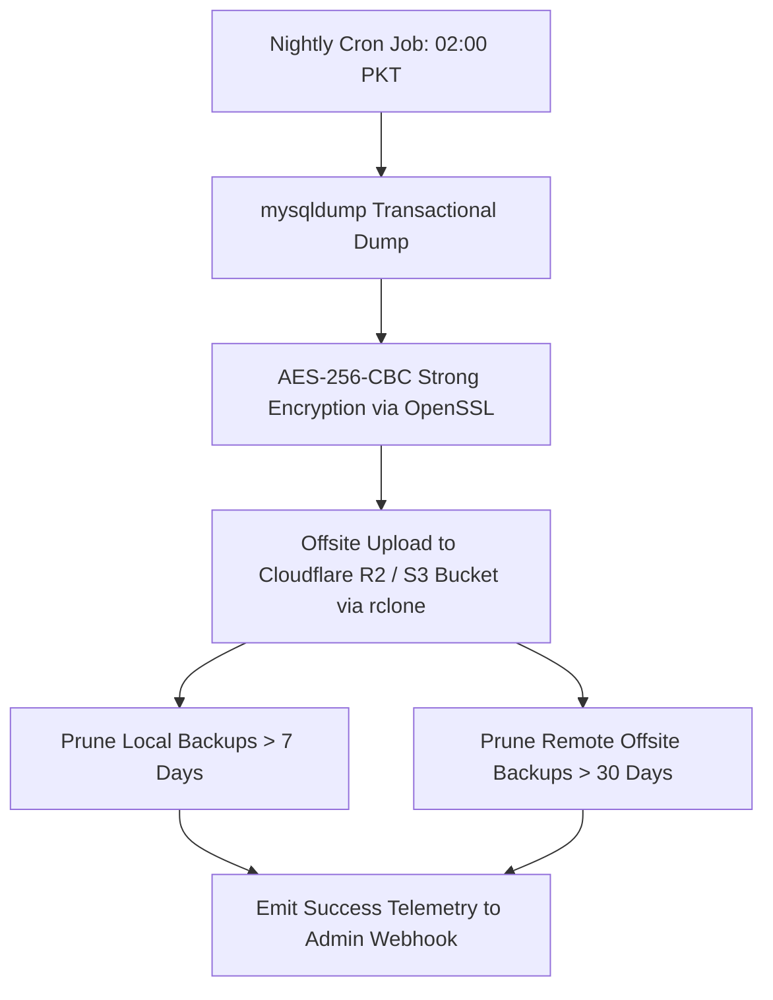

# BLUEBELLS SCHOOLING SYSTEM
## Module H — Backup, Encryption & Disaster Recovery Plan

**Document Reference:** `BSS-DEP-007`  
**Institution:** Bluebells Schooling System, Hyderabad, Sindh, Pakistan  
**Author:** Ahmed Ali Khan <medlykhan@gmail.com>  
**Status:** Approved Institutional Policy  

---

### 1. Executive Summary & Continuity Targets

The Bluebells Schooling System maintains mission-critical student academic records, examination gradebooks, fee financial ledgers, and identity verification credentials. Data loss or corruption directly impacts institutional operations and student legal documentation.

#### 1.1 Institutional Business Continuity Targets

| Metric | Target SLA | Operational Implementation |
| :--- | :--- | :--- |
| **Recovery Point Objective (RPO)** | **$\le 24$ Hours** (Target) <br/> **$\le 6$ Hours** (Peak exam/admission periods) | Automated nightly logical dump at 02:00 Asia/Karachi (PKT) plus mid-day incremental snapshots during examination weeks. |
| **Recovery Time Objective (RTO)** | **$\le 2$ Hours** | Automated restore script capable of re-provisioning database container and re-importing encrypted dump within 30 minutes. |

---

### 2. Automated Logical Backup Architecture

#### 2.1 MySQL 8.0 Dump Procedure
For production MySQL 8 instances (including Oracle Cloud Always Free and dedicated servers), logical backups are generated via `mysqldump` using transactional snapshot consistency:

```bash
#!/usr/bin/env bash
set -euo pipefail

BACKUP_DATE=$(date +%Y%m%d_%H%M%S)
BACKUP_DIR="/var/backups/bluebells"
DUMP_FILE="${BACKUP_DIR}/bluebells_backup_${BACKUP_DATE}.sql"
ENCRYPTED_FILE="${DUMP_FILE}.enc"

mkdir -p "$BACKUP_DIR"

echo "Executing consistent transactional logical dump..."
mysqldump \
  --host="${DB_HOST:-localhost}" \
  --port="${DB_PORT:-3306}" \
  --user="${DB_USER:-bluebells_user}" \
  --password="${DB_PASSWORD}" \
  --single-transaction \
  --quick \
  --routines \
  --triggers \
  --default-character-set=utf8mb4 \
  "${DB_NAME:-bluebells_school_db}" > "$DUMP_FILE"

echo "Compressing and encrypting dump file (AES-256-CBC)..."
openssl enc -aes-256-cbc -salt -pbkdf2 -iter 100000 \
  -in "$DUMP_FILE" \
  -out "$ENCRYPTED_FILE" \
  -pass "pass:${BACKUP_ENCRYPTION_PASSPHRASE}"

# Remove raw unencrypted SQL dump immediately
rm -f "$DUMP_FILE"

echo "Encrypted backup created: $ENCRYPTED_FILE"
```

#### 2.2 TiDB Cloud Serverless Automated Backups
- TiDB Cloud Serverless provides built-in automated daily backups with **1-day retention** on the free tier.
- To maintain 30-day institutional compliance, execute the logical backup script above using TiDB credentials or use the `dumpling` utility:
  ```bash
  dumpling -u $DB_USER -p $DB_PASSWORD -h $DB_HOST -P $DB_PORT \
    --filetype sql \
    -B $DB_NAME \
    -o /var/backups/tidb_dump
  ```

---

### 3. Offsite Storage & Retention Policy

To protect against physical datacenter failures, hardware corruption, or host account suspension, encrypted backups must be synchronized offsite to an independent cloud storage bucket (such as Cloudflare R2 or Backblaze B2).



#### 3.1 Offsite Synchronization Script (`backup-and-sync.sh`)
```bash
# Upload encrypted archive to Cloudflare R2 offsite bucket
rclone copy "$ENCRYPTED_FILE" "r2:bluebells-institution-backups/daily/"

# Enforce local 7-day retention
find "$BACKUP_DIR" -type f -name "*.enc" -mtime +7 -delete
```

---

### 4. Step-by-Step Restoration & Recovery Runbook

In a disaster scenario (e.g. database host failure, accidental administrative truncation, ransomware):

#### 4.1 Step 1: Prepare Clean Target Database
```bash
mysql -h $TARGET_HOST -P $TARGET_PORT -u root -p$TARGET_ROOT_PASSWORD -e "
  DROP DATABASE IF EXISTS bluebells_school_db;
  CREATE DATABASE bluebells_school_db 
    CHARACTER SET utf8mb4 
    COLLATE utf8mb4_unicode_ci;
"
```

#### 4.2 Step 2: Decrypt Backup Archive
```bash
openssl enc -d -aes-256-cbc -pbkdf2 -iter 100000 \
  -in "/var/backups/bluebells/bluebells_backup_20261117_020000.sql.enc" \
  -out "/var/backups/bluebells/restored.sql" \
  -pass "pass:${BACKUP_ENCRYPTION_PASSPHRASE}"
```

#### 4.3 Step 3: Stream Restoration into Target Database
```bash
mysql -h $TARGET_HOST -P $TARGET_PORT -u bluebells_user -p$DB_PASSWORD \
  --default-character-set=utf8mb4 \
  bluebells_school_db < /var/backups/bluebells/restored.sql

# Securely shred decrypted SQL file
rm -f /var/backups/bluebells/restored.sql
```

#### 4.4 Step 4: Verify Data Integrity Post-Restoration
Execute the following verification query to ensure all modules are intact:
```sql
SELECT 
  (SELECT COUNT(*) FROM users) AS total_users,
  (SELECT COUNT(*) FROM students) AS total_students,
  (SELECT COUNT(*) FROM fee_vouchers) AS total_fee_vouchers,
  (SELECT COUNT(*) FROM exam_gradebooks) AS total_gradebooks,
  (SELECT COUNT(*) FROM support_tickets) AS total_support_tickets;
```

---

### 5. Scheduled Recovery Drill Schedule

To guarantee that disaster recovery is not merely theoretical:
- **Frequency:** Monthly on the first Sunday at 22:00 PKT.
- **Procedure:** Restore the latest encrypted offsite backup into an isolated local staging database.
- **Pass Criteria:** All integrity query counts match the production snapshot within 0.0% variance, and the staging backend starts with Flyway validating schema integrity.
