# Bluebells Schooling System — Quality Assurance & Testing Master Plan

**System**: Bluebells Schooling System  
**Lead QA Architect**: Ahmed Ali Khan <medlykhan@gmail.com>  
**Test Automation Stack**: JUnit 5, Spring MockMvc, AssertJ, Jayway JsonPath, Vitest, Testing Library  
**Date**: November 2026  

---

## 1. Testing Strategy & Objectives

The Bluebells Schooling System Quality Assurance Plan ensures:
1. **Functional Correctness**: All academic, financial, administrative, and developmental workflows operate exactly according to institutional rules.
2. **Access Control & RBAC**: Every endpoint enforces least-privilege role boundaries; IDOR checks prevent lateral data leakage between families and unauthorized roles.
3. **Data Integrity & Consistency**: Multi-table operations commit atomically with complete rollback on failures.
4. **Resilience & Fault Tolerance**: External gateways operate cleanly in simulated mode and degrade gracefully on network drops.
5. **Regression Prevention**: 100% of existing workflows remain uninterrupted upon deploying new features.

---

## 2. Test Suites Architecture

```mermaid
graph TD
    A[Bluebells Test Framework] --> B[Backend Automated Suite]
    A --> C[Frontend Vitest Suite]
    
    B --> B1[Core Module Integration Tests]
    B --> B2[Security & RBAC Isolation Tests]
    B --> B3[Advanced Modules Verification Tests]
    
    B1 --> B1a[Admission & Enrollment Lifecycle]
    B1 --> B1b[Fee Invoicing & Payment Reconciliation]
    B1 --> B1c[Exam Grading & Report Card Generation]
    B1 --> B1d[Timetable Clash Detection Engine]
    
    B2 --> B2a[Multi-Child Guardian Privacy]
    B2 --> B2b[Support Ticket Parent Privacy]
    B2 --> B2c[Accountant Least-Privilege Isolation]
    
    B3 --> B3a[Management Analytics & Multi-Sheet Excel]
    B3 --> B3b[Student Development Approval Lifecycle]
    B3 --> B3c[Cryptographic ID Card QR Verification]
    B3 --> B3d[Official Certificate Sanitization & Revocation]
    B3 --> B3e[Integrations Console Masking & Ping]
    B3 --> B3f[Virtual Assistant Factual Query Answering]
    
    C --> C1[Navigation & Role-Based Layout Suite]
    C --> C2[LMS Courseware & Grading Suite]
    C --> C3[Advanced Modules UI & Least Privilege Suite]
```



---

## 3. Test Cases & Verification Matrix

| Test Suite Class | Tests Count | Scope & Verification Target |
| :--- | :--- | :--- |
| `AdmissionToEnrollmentLifecycleTest` | 1 | Complete student application -> interview -> document verification -> enrollment -> roll number assignment. |
| `FeeInvoiceAndPaymentLifecycleTest` | 1 | Invoice billing, scholarship discount validation, partial payment tracking, overpayment prevention. |
| `ExaminationAndReportCardLifecycleTest` | 1 | Exam scheduling, marks entry, max marks validation, publishing lock, A3 report card calculations. |
| `TimetableClashDetectionTest` | 1 | Detection and prevention of teacher double-booking, room clash, and section time conflicts. |
| `NotificationAndReportingLifecycleTest` | 1 | Outgoing email/SMS dispatch and parent notification delivery. |
| `GuardianMultiChildIsolationTest` | 1 | Strict isolation preventing Parent A from reading Parent B's children records. |
| `SupportTicketPrivacyTest` | 4 | Parent isolation on tickets, staff reply handling, hiding internal notes from parents, ticket resolution. |
| `ManagementAnalyticsTest` | 7 | Executive overview, demographics, attendance rates, accountant 403 isolation, financial endpoint access, Excel generation. |
| `StudentDevelopmentTest` | 4 | Teacher milestone creation (`PENDING_REVIEW`), leadership verification (`VERIFIED`), rejection, parent view filtering. |
| `StudentIdCardTest` | 3 | ID card generation, high-entropy UUID token verification, reissue count incrementing. |
| `CertificateServiceTest` | 3 | Certificate issuance, mandatory revocation reason enforcement, public verification lookup. |
| `SchoolIntegrationTest` | 4 | Connector listing, secret masking in DTOs, heartbeat ping latency, student 403 isolation. |
| `SchoolAssistantTest` | 4 | Factual question answering, admission inquiry handling, prompt injection defense, unknown query fallback. |
| `AcademicsIntegrationTest` | 15+ | Academic session, class, section, and subject CRUD and validation. |
| `AuthenticationIntegrationTest` | 12+ | Login, JWT generation, invalid credentials, persona switching. |
| `DataImportTest` / Regression | 15+ | Bulk import template parsing, validation error handling, duplicate CNIC detection. |
| **Frontend Suites** (`App`, `Lms`, `AdvancedModules`) | 17 | Persona navigation, LMS course filters, role-based tab isolation, modal triggers. |

---

## 4. Execution Commands

```bash
# Backend test execution
mvn test

# Targeted advanced module execution
mvn test -Dtest=ManagementAnalyticsTest,StudentDevelopmentTest,StudentIdCardTest,CertificateServiceTest,SupportTicketPrivacyTest,SchoolAssistantTest,SchoolIntegrationTest

# Frontend Vitest execution
npm test -- --run
```
