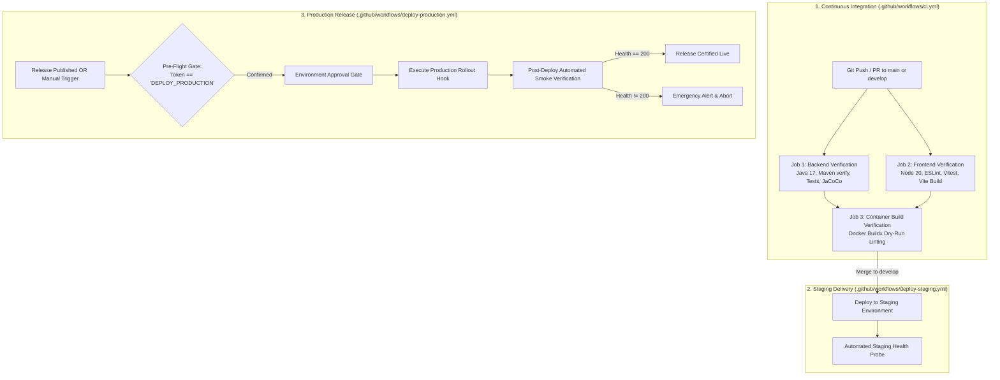

# BLUEBELLS SCHOOLING SYSTEM
## Module H — Continuous Integration & Continuous Delivery (CI/CD) Implementation Report

**Document Reference:** `BSS-DEP-009`  
**Institution:** Bluebells Schooling System, Hyderabad, Sindh, Pakistan  
**Author:** Ahmed Ali Khan <medlykhan@gmail.com>  
**CI/CD Engine:** GitHub Actions  
**Status:** Implemented & Verified  

---

### 1. Executive Summary

This report documents the automated Continuous Integration and Continuous Delivery (CI/CD) pipelines implemented for the Bluebells Schooling System. The pipeline architecture enforces strict quality gates, automated regression testing, container linting, and role-gated production deployments.

---

### 2. Workflow Pipeline Architecture



---

### 3. Pipeline Specifications & Implementation Details

#### 3.1 Continuous Integration Workflow ([`.github/workflows/ci.yml`](file:///Users/ahmkhan/Desktop/portal/.github/workflows/ci.yml))
- **Trigger Conditions:** Every `push` to `main`, `develop`, and `feature/**` branches; every `pull_request` targeting `main` or `develop`.
- **Concurrency Control:** Cancels stale in-progress workflow runs for the same ref, conserving GitHub Actions minutes.
- **Job 1: Backend Verification:**
  - Installs Eclipse Temurin JDK 17 with Maven caching.
  - Executes `mvn clean verify -B` to run all 25+ Spring Boot tests and static checks.
  - Archives Surefire test XML reports and JaCoCo coverage binaries as build artifacts.
- **Job 2: Frontend Verification:**
  - Installs Node.js 20 with npm dependency caching.
  - Executes `npm ci` for deterministic package resolution.
  - Executes ESLint (`npm run lint`) with `--max-warnings 0`.
  - Executes Vitest test suite (`npm test`).
  - Executes production bundle compilation (`npm run build`).
  - Archives the `dist/` directory as a verified build artifact.
- **Job 3: Container Build Verification:**
  - Runs in parallel after backend and frontend verifications pass.
  - Uses `docker/setup-buildx-action` to build both `backend/Dockerfile` and `frontend/Dockerfile` without pushing to a registry, catching any broken Docker instructions prior to merge.

#### 3.2 Staging Deployment Workflow ([`.github/workflows/deploy-staging.yml`](file:///Users/ahmkhan/Desktop/portal/.github/workflows/deploy-staging.yml))
- **Trigger Conditions:** Automatic push to `develop` branch or manual `workflow_dispatch`.
- **Environment:** Tied to GitHub Environment `staging`.
- **Action:** Triggers staging webhooks and polls the staging health URL for up to 5 attempts (HTTP 200 verification).

#### 3.3 Production Release Workflow ([`.github/workflows/deploy-production.yml`](file:///Users/ahmkhan/Desktop/portal/.github/workflows/deploy-production.yml))
- **Trigger Conditions:** GitHub Release publication or manual `workflow_dispatch`.
- **Safety Token Verification:** If triggered manually, the operator must explicitly enter `DEPLOY_PRODUCTION` in the confirmation input. Any other text immediately fails the pre-flight check.
- **Environment Governance:** Targets the protected GitHub Environment `production`, enforcing required manual reviewer sign-off from designated administrators.
- **Post-Deploy Smoke Probing:** Executes up to 12 automated polling probes (15-second intervals) against `PROD_BACKEND_HEALTH_URL` and `PROD_FRONTEND_URL` to confirm healthy deployment before completing the pipeline.

---

### 4. Branch Protection & Governance Standards

To ensure software integrity, the repository administrator must configure the following Branch Protection Rules in GitHub:

```
Branch name pattern: main
[x] Require a pull request before merging
    [x] Require approvals: 1
    [x] Dismiss stale pull request approvals when new commits are pushed
[x] Require status checks to pass before merging
    [x] Require branches to be up to date before merging
    - backend-verification
    - frontend-verification
    - docker-verification
[x] Require conversation resolution before merging
[x] Do not allow bypassing the above settings
```

---

### 5. GitHub Secrets & Secrets Isolation

Production credentials must never be stored as repository-level secrets accessible to all pull requests. They must be isolated within the **GitHub Environment: production**:

| Secret Name | Scope | Description |
| :--- | :--- | :--- |
| `PROD_BACKEND_DEPLOY_HOOK` | Environment (`production`) | Secure deployment webhook triggering backend PaaS rollout. |
| `PROD_FRONTEND_DEPLOY_HOOK` | Environment (`production`) | Secure deployment webhook triggering frontend static CDN rollout. |
| `PROD_BACKEND_HEALTH_URL` | Environment (`production`) | Public health check URL (`https://api.bluebells.edu.pk/actuator/health`). |
| `PROD_FRONTEND_URL` | Environment (`production`) | Public portal URL (`https://portal.bluebells.edu.pk`). |
| `STAGING_BACKEND_DEPLOY_HOOK` | Environment (`staging`) | Staging backend deployment webhook. |
| `STAGING_FRONTEND_DEPLOY_HOOK` | Environment (`staging`) | Staging frontend deployment webhook. |
| `STAGING_HEALTH_URL` | Environment (`staging`) | Staging health probe URL. |
