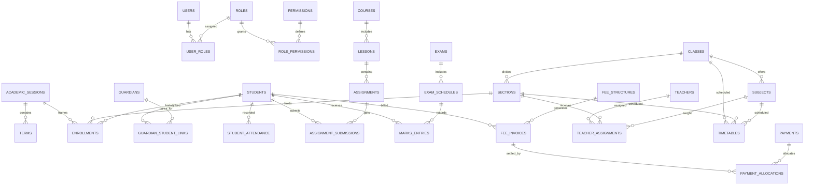

# Database Design & Schema Specification — Bluebells School LMS

## 1. Design Principles & Data Integrity

1. **Relational Normalization & Integrity**: 3NF normalized schema enforcing foreign keys (`ON DELETE RESTRICT` or `ON DELETE CASCADE` appropriately), unique constraints, and check constraints.
2. **Deterministic Versioned Migrations**: Managed exclusively via Flyway (`db/migration/mysql/V{version}__{description}.sql`). Never use Hibernate `hbm2ddl.auto=update` or `create-drop` in production.
3. **Monetary Precision**: All monetary values (`fees`, `payments`, `balances`, `discounts`) are modeled as `DECIMAL(12, 2)` (Pakistani Rupee PKR). Floating point (`FLOAT`, `DOUBLE`) arithmetic is strictly prohibited.
4. **Timestamping & Timezone**:
   - Stored in UTC using `DATETIME(6)` or `TIMESTAMP`.
   - Business dates (e.g. `attendance_date`, `due_date`, `exam_date`) are stored as `DATE`.
   - Display and query interpretation uses `Asia/Karachi` (UTC+5).
5. **Auditing & Immutability**:
   - `created_at`, `updated_at`, `created_by`, `updated_by`, and optimistic `version` columns on all mutable records.
   - Financial ledger entries (`payments`, `payment_allocations`) and published examination results are strictly append-only and immutable. Corrections must be handled through audited reversal or adjustment entries.

---

## 2. Entity-Relationship Overview

---

## 3. Detailed Table Schema Definitions

### Module A: Identity & RBAC
- **`users`**:
  - `id` BIGINT AUTO_INCREMENT PRIMARY KEY
  - `username` VARCHAR(64) NOT NULL UNIQUE
  - `email` VARCHAR(128) NOT NULL UNIQUE
  - `password_hash` VARCHAR(255) NOT NULL
  - `full_name` VARCHAR(128) NOT NULL
  - `phone_number` VARCHAR(32)
  - `status` ENUM('ACTIVE', 'SUSPENDED', 'PENDING_ACTIVATION') NOT NULL DEFAULT 'ACTIVE'
  - `failed_login_attempts` INT NOT NULL DEFAULT 0
  - `locked_until` DATETIME(6) NULL
  - `last_login_at` DATETIME(6) NULL
  - `created_at` DATETIME(6) NOT NULL DEFAULT CURRENT_TIMESTAMP(6)
  - `updated_at` DATETIME(6) NOT NULL DEFAULT CURRENT_TIMESTAMP(6) ON UPDATE CURRENT_TIMESTAMP(6)
  - `version` BIGINT NOT NULL DEFAULT 0
- **`roles`**:
  - `id` BIGINT AUTO_INCREMENT PRIMARY KEY
  - `name` VARCHAR(64) NOT NULL UNIQUE (`SUPER_ADMIN`, `SCHOOL_ADMIN`, `PRINCIPAL`, `TEACHER`, `PARENT`, `STUDENT`, `ACCOUNTANT`)
  - `description` VARCHAR(255)
- **`permissions`**:
  - `id` BIGINT AUTO_INCREMENT PRIMARY KEY
  - `code` VARCHAR(64) NOT NULL UNIQUE (e.g. `STUDENT_READ`, `FEES_WRITE`, `ATTENDANCE_CORRECT`)
  - `module` VARCHAR(64) NOT NULL
  - `description` VARCHAR(255)
- **`user_roles`**:
  - `user_id` BIGINT NOT NULL, `role_id` BIGINT NOT NULL, PRIMARY KEY (`user_id`, `role_id`)
- **`role_permissions`**:
  - `role_id` BIGINT NOT NULL, `permission_id` BIGINT NOT NULL, PRIMARY KEY (`role_id`, `permission_id`)

### Module B: School Setup & Academics
- **`school_profile`**:
  - `id` BIGINT AUTO_INCREMENT PRIMARY KEY
  - `name` VARCHAR(128) NOT NULL (Default: "Bluebells Schooling System")
  - `address` TEXT NOT NULL
  - `email` VARCHAR(128) NOT NULL
  - `phone` VARCHAR(32) NOT NULL
  - `logo_url` VARCHAR(255)
  - `currency` VARCHAR(8) NOT NULL DEFAULT 'PKR'
  - `timezone` VARCHAR(64) NOT NULL DEFAULT 'Asia/Karachi'
  - `created_at`, `updated_at` DATETIME(6)
- **`academic_sessions`**:
  - `id` BIGINT AUTO_INCREMENT PRIMARY KEY
  - `name` VARCHAR(64) NOT NULL UNIQUE (e.g. "2026-2027")
  - `start_date` DATE NOT NULL
  - `end_date` DATE NOT NULL
  - `is_current` BOOLEAN NOT NULL DEFAULT FALSE
  - `created_at`, `updated_at` DATETIME(6)
- **`terms`**:
  - `id` BIGINT AUTO_INCREMENT PRIMARY KEY
  - `session_id` BIGINT NOT NULL REFERENCES `academic_sessions`(`id`)
  - `name` VARCHAR(64) NOT NULL (e.g. "First Term", "Final Term")
  - `start_date` DATE NOT NULL
  - `end_date` DATE NOT NULL
  - `weight_percentage` DECIMAL(5,2) DEFAULT 50.00
- **`grade_levels`**:
  - `id` BIGINT AUTO_INCREMENT PRIMARY KEY
  - `name` VARCHAR(64) NOT NULL UNIQUE (e.g. "Nursery", "Kindergarten", "Grade 1"..."Grade 10")
  - `stage` ENUM('PRE_PRIMARY', 'PRIMARY', 'MIDDLE', 'SECONDARY') NOT NULL
  - `display_order` INT NOT NULL DEFAULT 0
- **`classes`**:
  - `id` BIGINT AUTO_INCREMENT PRIMARY KEY
  - `grade_level_id` BIGINT NOT NULL REFERENCES `grade_levels`(`id`)
  - `name` VARCHAR(64) NOT NULL (e.g. "Class 1", "Class 9")
  - `code` VARCHAR(32) NOT NULL UNIQUE
- **`sections`**:
  - `id` BIGINT AUTO_INCREMENT PRIMARY KEY
  - `class_id` BIGINT NOT NULL REFERENCES `classes`(`id`)
  - `name` VARCHAR(32) NOT NULL (e.g. "A", "B", "Rose", "Jasmine")
  - `room_number` VARCHAR(32)
  - `max_capacity` INT NOT NULL DEFAULT 35
  - UNIQUE(`class_id`, `name`)
- **`subjects`**:
  - `id` BIGINT AUTO_INCREMENT PRIMARY KEY
  - `class_id` BIGINT NOT NULL REFERENCES `classes`(`id`)
  - `name` VARCHAR(128) NOT NULL (e.g. "Mathematics", "English", "Urdu", "Sindhi", "Islamiat", "General Science")
  - `code` VARCHAR(32) NOT NULL
  - `is_elective` BOOLEAN NOT NULL DEFAULT FALSE
  - `total_marks` INT NOT NULL DEFAULT 100
  - UNIQUE(`class_id`, `code`)

### Module C: Admissions, Students & Guardians
- **`admission_applications`**:
  - `id` BIGINT AUTO_INCREMENT PRIMARY KEY
  - `application_number` VARCHAR(32) NOT NULL UNIQUE
  - `applicant_name` VARCHAR(128) NOT NULL
  - `date_of_birth` DATE NOT NULL
  - `gender` ENUM('MALE', 'FEMALE', 'OTHER') NOT NULL
  - `applied_class_id` BIGINT NOT NULL REFERENCES `classes`(`id`)
  - `guardian_name` VARCHAR(128) NOT NULL
  - `guardian_phone` VARCHAR(32) NOT NULL
  - `guardian_cnic` VARCHAR(32)
  - `status` ENUM('SUBMITTED', 'UNDER_REVIEW', 'INTERVIEW_SCHEDULED', 'OFFERED', 'ENROLLED', 'REJECTED') NOT NULL DEFAULT 'SUBMITTED'
  - `notes` TEXT
  - `created_at`, `updated_at` DATETIME(6)
- **`students`**:
  - `id` BIGINT AUTO_INCREMENT PRIMARY KEY
  - `user_id` BIGINT UNIQUE REFERENCES `users`(`id`)
  - `admission_number` VARCHAR(32) NOT NULL UNIQUE (e.g. "BSS-2026-0001")
  - `first_name` VARCHAR(64) NOT NULL
  - `last_name` VARCHAR(64) NOT NULL
  - `date_of_birth` DATE NOT NULL
  - `gender` ENUM('MALE', 'FEMALE', 'OTHER') NOT NULL
  - `blood_group` VARCHAR(8)
  - `b_form_number` VARCHAR(32)
  - `residential_address` TEXT NOT NULL
  - `admission_date` DATE NOT NULL
  - `status` ENUM('ACTIVE', 'WITHDRAWN', 'GRADUATED', 'TRANSFERRED') NOT NULL DEFAULT 'ACTIVE'
  - `photo_url` VARCHAR(255)
  - `version` BIGINT NOT NULL DEFAULT 0
- **`guardians`**:
  - `id` BIGINT AUTO_INCREMENT PRIMARY KEY
  - `user_id` BIGINT UNIQUE REFERENCES `users`(`id`)
  - `full_name` VARCHAR(128) NOT NULL
  - `relationship_type` ENUM('FATHER', 'MOTHER', 'LEGAL_GUARDIAN', 'OTHER') NOT NULL
  - `cnic_number` VARCHAR(32)
  - `phone_primary` VARCHAR(32) NOT NULL
  - `phone_secondary` VARCHAR(32)
  - `occupation` VARCHAR(64)
  - `address` TEXT
- **`guardian_student_links`**:
  - `guardian_id` BIGINT NOT NULL REFERENCES `guardians`(`id`),
  - `student_id` BIGINT NOT NULL REFERENCES `students`(`id`),
  - `is_primary_contact` BOOLEAN NOT NULL DEFAULT TRUE,
  - `is_financial_sponsor` BOOLEAN NOT NULL DEFAULT TRUE,
  - PRIMARY KEY (`guardian_id`, `student_id`)
- **`enrollments`**:
  - `id` BIGINT AUTO_INCREMENT PRIMARY KEY
  - `student_id` BIGINT NOT NULL REFERENCES `students`(`id`)
  - `session_id` BIGINT NOT NULL REFERENCES `academic_sessions`(`id`)
  - `section_id` BIGINT NOT NULL REFERENCES `sections`(`id`)
  - `roll_number` VARCHAR(16)
  - `enrollment_status` ENUM('ACTIVE', 'PROMOTED', 'DETAINED', 'TRANSFERRED') NOT NULL DEFAULT 'ACTIVE'
  - `enrollment_date` DATE NOT NULL
  - UNIQUE(`student_id`, `session_id`)

### Module D & E: Attendance & Timetable
- **`timetables`**:
  - `id` BIGINT AUTO_INCREMENT PRIMARY KEY
  - `session_id` BIGINT NOT NULL REFERENCES `academic_sessions`(`id`)
  - `section_id` BIGINT NOT NULL REFERENCES `sections`(`id`)
  - `subject_id` BIGINT NOT NULL REFERENCES `subjects`(`id`)
  - `teacher_id` BIGINT NOT NULL REFERENCES `users`(`id`)
  - `day_of_week` ENUM('MONDAY', 'TUESDAY', 'WEDNESDAY', 'THURSDAY', 'FRIDAY', 'SATURDAY') NOT NULL
  - `start_time` TIME NOT NULL
  - `end_time` TIME NOT NULL
  - `room_number` VARCHAR(32)
- **`student_attendance`**:
  - `id` BIGINT AUTO_INCREMENT PRIMARY KEY
  - `enrollment_id` BIGINT NOT NULL REFERENCES `enrollments`(`id`)
  - `attendance_date` DATE NOT NULL
  - `status` ENUM('PRESENT', 'ABSENT', 'LATE', 'EXCUSED') NOT NULL
  - `remarks` VARCHAR(255)
  - `recorded_by` BIGINT NOT NULL REFERENCES `users`(`id`)
  - `created_at` DATETIME(6) NOT NULL DEFAULT CURRENT_TIMESTAMP(6)
  - `version` BIGINT NOT NULL DEFAULT 0
  - UNIQUE(`enrollment_id`, `attendance_date`)

### Module F: LMS & Assignments
- **`courses`**:
  - `id` BIGINT AUTO_INCREMENT PRIMARY KEY
  - `subject_id` BIGINT NOT NULL REFERENCES `subjects`(`id`)
  - `section_id` BIGINT NOT NULL REFERENCES `sections`(`id`)
  - `teacher_id` BIGINT NOT NULL REFERENCES `users`(`id`)
  - `title` VARCHAR(128) NOT NULL
  - `description` TEXT
  - `status` ENUM('DRAFT', 'PUBLISHED', 'ARCHIVED') NOT NULL DEFAULT 'PUBLISHED'
- **`lessons`**:
  - `id` BIGINT AUTO_INCREMENT PRIMARY KEY
  - `course_id` BIGINT NOT NULL REFERENCES `courses`(`id`)
  - `title` VARCHAR(128) NOT NULL
  - `content` TEXT
  - `sequence_order` INT NOT NULL DEFAULT 0
  - `published_at` DATETIME(6)
- **`assignments`**:
  - `id` BIGINT AUTO_INCREMENT PRIMARY KEY
  - `course_id` BIGINT NOT NULL REFERENCES `courses`(`id`)
  - `title` VARCHAR(128) NOT NULL
  - `instructions` TEXT NOT NULL
  - `max_marks` DECIMAL(5,2) NOT NULL DEFAULT 100.00
  - `due_date` DATETIME(6) NOT NULL
  - `allow_late_submission` BOOLEAN NOT NULL DEFAULT FALSE
  - `status` ENUM('DRAFT', 'PUBLISHED', 'CLOSED') NOT NULL DEFAULT 'DRAFT'
  - `created_at`, `updated_at` DATETIME(6)
- **`assignment_submissions`**:
  - `id` BIGINT AUTO_INCREMENT PRIMARY KEY
  - `assignment_id` BIGINT NOT NULL REFERENCES `assignments`(`id`)
  - `student_id` BIGINT NOT NULL REFERENCES `students`(`id`)
  - `submission_text` TEXT
  - `file_url` VARCHAR(255)
  - `submitted_at` DATETIME(6) NOT NULL
  - `is_late` BOOLEAN NOT NULL DEFAULT FALSE
  - `status` ENUM('SUBMITTED', 'GRADED', 'RESUBMISSION_REQUESTED') NOT NULL DEFAULT 'SUBMITTED'
  - `marks_obtained` DECIMAL(5,2)
  - `teacher_feedback` TEXT
  - `graded_at` DATETIME(6)
  - `graded_by` BIGINT REFERENCES `users`(`id`)
  - UNIQUE(`assignment_id`, `student_id`)

### Module G: Examinations & Results
- **`exams`**:
  - `id` BIGINT AUTO_INCREMENT PRIMARY KEY
  - `session_id` BIGINT NOT NULL REFERENCES `academic_sessions`(`id`)
  - `term_id` BIGINT NOT NULL REFERENCES `terms`(`id`)
  - `name` VARCHAR(128) NOT NULL (e.g. "Midterm Examination 2026", "Final Annual Examination")
  - `start_date` DATE NOT NULL
  - `end_date` DATE NOT NULL
  - `status` ENUM('PLANNED', 'IN_PROGRESS', 'MARKS_ENTRY', 'PUBLISHED', 'COMPLETED') NOT NULL DEFAULT 'PLANNED'
- **`grading_scales`**:
  - `id` BIGINT AUTO_INCREMENT PRIMARY KEY
  - `grade` VARCHAR(8) NOT NULL (e.g. "A+", "A", "B", "C", "D", "F")
  - `min_percentage` DECIMAL(5,2) NOT NULL
  - `max_percentage` DECIMAL(5,2) NOT NULL
  - `grade_point` DECIMAL(4,2) NOT NULL
  - `remarks` VARCHAR(64)
- **`marks_entries`**:
  - `id` BIGINT AUTO_INCREMENT PRIMARY KEY
  - `exam_id` BIGINT NOT NULL REFERENCES `exams`(`id`)
  - `subject_id` BIGINT NOT NULL REFERENCES `subjects`(`id`)
  - `student_id` BIGINT NOT NULL REFERENCES `students`(`id`)
  - `marks_obtained` DECIMAL(5,2) NOT NULL
  - `max_marks` DECIMAL(5,2) NOT NULL DEFAULT 100.00
  - `grade` VARCHAR(8)
  - `is_absent` BOOLEAN NOT NULL DEFAULT FALSE
  - `status` ENUM('DRAFT', 'SUBMITTED', 'APPROVED', 'PUBLISHED') NOT NULL DEFAULT 'DRAFT'
  - `recorded_by` BIGINT NOT NULL REFERENCES `users`(`id`)
  - `version` BIGINT NOT NULL DEFAULT 0
  - UNIQUE(`exam_id`, `subject_id`, `student_id`)

### Module H: Fees & Finance
- **`fee_categories`**:
  - `id` BIGINT AUTO_INCREMENT PRIMARY KEY
  - `name` VARCHAR(64) NOT NULL UNIQUE (e.g. "Tuition Fee", "Admission Fee", "Annual Examination Fee", "Computer Lab Fee")
  - `is_recurring` BOOLEAN NOT NULL DEFAULT TRUE
- **`fee_structures`**:
  - `id` BIGINT AUTO_INCREMENT PRIMARY KEY
  - `session_id` BIGINT NOT NULL REFERENCES `academic_sessions`(`id`)
  - `class_id` BIGINT NOT NULL REFERENCES `classes`(`id`)
  - `category_id` BIGINT NOT NULL REFERENCES `fee_categories`(`id`)
  - `amount` DECIMAL(12, 2) NOT NULL
  - `frequency` ENUM('MONTHLY', 'QUARTERLY', 'ANNUAL', 'ONE_TIME') NOT NULL DEFAULT 'MONTHLY'
  - UNIQUE(`session_id`, `class_id`, `category_id`)
- **`fee_invoices`**:
  - `id` BIGINT AUTO_INCREMENT PRIMARY KEY
  - `invoice_number` VARCHAR(32) NOT NULL UNIQUE (e.g. "INV-2026-10-0012")
  - `student_id` BIGINT NOT NULL REFERENCES `students`(`id`)
  - `session_id` BIGINT NOT NULL REFERENCES `academic_sessions`(`id`)
  - `billing_month` VARCHAR(16) NOT NULL (e.g. "2026-10")
  - `total_amount` DECIMAL(12, 2) NOT NULL
  - `discount_amount` DECIMAL(12, 2) NOT NULL DEFAULT 0.00
  - `paid_amount` DECIMAL(12, 2) NOT NULL DEFAULT 0.00
  - `balance_due` DECIMAL(12, 2) NOT NULL
  - `due_date` DATE NOT NULL
  - `status` ENUM('UNPAID', 'PARTIALLY_PAID', 'PAID', 'CANCELLED') NOT NULL DEFAULT 'UNPAID'
  - `version` BIGINT NOT NULL DEFAULT 0
  - `created_at`, `updated_at` DATETIME(6)
- **`payments`**:
  - `id` BIGINT AUTO_INCREMENT PRIMARY KEY
  - `payment_reference` VARCHAR(64) NOT NULL UNIQUE (e.g. "RCPT-2026-10-0045")
  - `student_id` BIGINT NOT NULL REFERENCES `students`(`id`)
  - `amount` DECIMAL(12, 2) NOT NULL
  - `payment_date` DATE NOT NULL
  - `payment_method` ENUM('CASH', 'BANK_TRANSFER', 'CHEQUE', 'ONLINE') NOT NULL DEFAULT 'CASH'
  - `received_by` BIGINT NOT NULL REFERENCES `users`(`id`)
  - `notes` VARCHAR(255)
  - `status` ENUM('CLEARED', 'REVERSED') NOT NULL DEFAULT 'CLEARED'
  - `created_at` DATETIME(6) NOT NULL DEFAULT CURRENT_TIMESTAMP(6)
- **`payment_allocations`**:
  - `id` BIGINT AUTO_INCREMENT PRIMARY KEY
  - `payment_id` BIGINT NOT NULL REFERENCES `payments`(`id`)
  - `invoice_id` BIGINT NOT NULL REFERENCES `fee_invoices`(`id`)
  - `allocated_amount` DECIMAL(12, 2) NOT NULL

### Module I, J, K: Notifications, Audit & Documents
- **`notifications`**:
  - `id` BIGINT AUTO_INCREMENT PRIMARY KEY
  - `recipient_id` BIGINT NOT NULL REFERENCES `users`(`id`)
  - `title` VARCHAR(128) NOT NULL
  - `message` TEXT NOT NULL
  - `category` ENUM('ACADEMIC', 'ATTENDANCE', 'FEE', 'SYSTEM', 'ANNOUNCEMENT') NOT NULL
  - `is_read` BOOLEAN NOT NULL DEFAULT FALSE
  - `created_at` DATETIME(6) NOT NULL DEFAULT CURRENT_TIMESTAMP(6)
- **`audit_logs`**:
  - `id` BIGINT AUTO_INCREMENT PRIMARY KEY
  - `principal_username` VARCHAR(64) NOT NULL
  - `action` VARCHAR(64) NOT NULL (e.g. `UPDATE_MARKS`, `REVERSE_PAYMENT`, `CHANGE_STUDENT_STATUS`)
  - `resource_type` VARCHAR(64) NOT NULL
  - `resource_id` VARCHAR(64) NOT NULL
  - `details` JSON
  - `client_ip` VARCHAR(45)
  - `timestamp` DATETIME(6) NOT NULL DEFAULT CURRENT_TIMESTAMP(6)
- **`document_metadata`**:
  - `id` BIGINT AUTO_INCREMENT PRIMARY KEY
  - `filename` VARCHAR(255) NOT NULL
  - `storage_path` VARCHAR(512) NOT NULL
  - `content_type` VARCHAR(64) NOT NULL
  - `file_size_bytes` BIGINT NOT NULL
  - `entity_type` VARCHAR(64) NOT NULL
  - `entity_id` BIGINT NOT NULL
  - `uploaded_by` BIGINT NOT NULL REFERENCES `users`(`id`)
  - `created_at` DATETIME(6) NOT NULL DEFAULT CURRENT_TIMESTAMP(6)

---

## 4. Key Performance Indexes

1. `idx_enrollment_lookup`: `enrollments(session_id, section_id, enrollment_status)`
2. `idx_attendance_date_section`: `student_attendance(attendance_date, enrollment_id)`
3. `idx_marks_student_exam`: `marks_entries(exam_id, student_id)`
4. `idx_invoice_student_status`: `fee_invoices(student_id, status)`
5. `idx_notifications_user_unread`: `notifications(recipient_id, is_read, created_at)`
6. `idx_audit_logs_timestamp`: `audit_logs(timestamp)`
