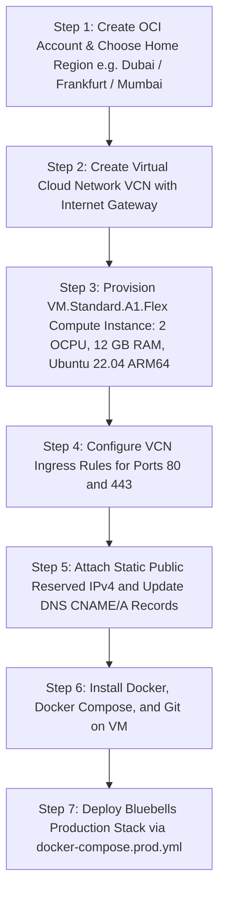

# BLUEBELLS SCHOOLING SYSTEM
## Module H — Oracle Cloud Infrastructure (OCI) Always Free Evaluation & Deployment Runbook

**Document Reference:** `BSS-DEP-008`  
**Institution:** Bluebells Schooling System, Hyderabad, Sindh, Pakistan  
**Author:** Ahmed Ali Khan <medlykhan@gmail.com>  
**Target Environment:** OCI Ampere A1 Compute (ARM64)  
**Status:** Highly Recommended for Production Architecture  

---

### 1. Executive Summary

While multi-tenant serverless tiers (Vercel + Render + TiDB) offer zero-cost staging, their operational limitations (50-second cold starts, 512 MB memory ceilings, and ephemeral container disks) prevent them from meeting institutional production standards.

**Oracle Cloud Infrastructure (OCI) Always Free** provides the industry's most generous perpetual free tier, delivering enterprise-grade compute and persistent storage at **$0.00 perpetual hosting cost**.

---

### 2. OCI Always Free Resource Entitlements

| Resource Category | OCI Always Free Allocation | Bluebells School Utilization Plan |
| :--- | :--- | :--- |
| **Compute Engine** | **Up to 4 OCPUs & 24 GB RAM** (Ampere A1 ARM Architecture) | Provision **1 VM with 2 OCPUs and 12 GB RAM** (Leaves 2 OCPUs / 12 GB RAM reserve for secondary staging VM). |
| **Block Volume Storage** | **200 GB Total Persistent Block Storage** | 50 GB OS Boot Volume + **150 GB Dedicated Storage Volume** for MySQL database files and student document archives. |
| **Outbound Data Transfer** | **10 TB / Month Free** | Covers 100% of school traffic (admissions, fee vouchers, daily LMS access) with 9.9 TB buffer. |
| **Public IPv4 Addresses** | **1 Reserved Public IPv4 Free** | Static public IP bound directly to school DNS (`portal.bluebells.edu.pk`). |
| **Virtual Cloud Network (VCN)** | Full private subnets, security lists, and gateway firewall rules. | Complete network isolation: MySQL port 3306 is locked to internal subnet, only ports 80/443 exposed publicly. |

---

### 3. Critical Realities, Nuances & Trade-Offs

#### 3.1 Credit Card Verification Requirement
- **Reality:** Unlike Render or Vercel, signing up for Oracle Cloud requires an active international credit or debit card for identity verification.
- **Billing Behavior:** Oracle executes a temporary authorization hold (typically ~$1 USD or PKR equivalent), which is reversed immediately. **No charges are incurred as long as resources remain within Always Free bounds.**
- **Protection:** Enable billing alerts in the OCI Console set to $0.01 threshold.

#### 3.2 OCI Idle Instance Reclamation Policy
- **The Policy:** In early 2023, Oracle instituted an idle compute reclamation policy: Always Free instances may be reclaimed by Oracle if, over a 7-day period:
  1. CPU utilization is less than 20% for 95% of the time, AND
  2. Network utilization is less than 20%, AND
  3. Memory utilization is less than 20% (for A1 shapes).
- **Impact on Bluebells:**
  - Running MySQL 8.0, Spring Boot 3 JRE (configured with 2 GB heap), Nginx, and daily scheduled health probes naturally consumes baseline memory and CPU.
  - A lightweight institutional maintenance script or periodic health probe ensures memory usage stays above the idle threshold.

#### 3.3 ARM64 (aarch64) Architecture Compatibility
- **Architecture:** The Ampere A1 processor runs the 64-bit ARM architecture (`linux/arm64`).
- **Java / Spring Boot Compatibility:** **100% Native.** OpenJDK and Eclipse Temurin have tier-1 native support for ARM64. In fact, Java 17 bytecode executes faster and with higher energy efficiency on Ampere A1 than on legacy x86 micro-instances.
- **Docker Multi-Arch Building:** Docker images must be built for `linux/arm64` using `docker buildx` or compiled directly on the OCI instance.

---

### 4. Step-by-Step OCI Instance Provisioning Guide



#### 4.1 Ingress Firewall Rules Configuration
In the OCI Console -> **Networking** -> **Virtual Cloud Networks** -> **Default Security List**:
Add the following Ingress Rules:
- **Port 80 (HTTP):** Source `0.0.0.0/0`, Protocol `TCP`, Destination Port `80`.
- **Port 443 (HTTPS):** Source `0.0.0.0/0`, Protocol `TCP`, Destination Port `443`.
- **Port 22 (SSH):** Source `YOUR_OFFICE_IP/32` (or restricted CIDR), Protocol `TCP`, Destination Port `22`.

#### 4.2 Host Operating System Preparation
SSH into the provisioned ARM64 instance:
```bash
# Update packages
sudo apt update && sudo apt upgrade -y

# Configure host iptables to permit forwarded Docker traffic (Ubuntu on OCI has strict default iptables)
sudo iptables -I INPUT 6 -m state --state NEW -p tcp --dport 80 -j ACCEPT
sudo iptables -I INPUT 6 -m state --state NEW -p tcp --dport 443 -j ACCEPT
sudo netfilter-persistent save

# Install Docker and Docker Compose Plugin
sudo apt install -y ca-certificates curl gnupg lsb-release
sudo mkdir -p /etc/apt/keyrings
curl -fsSL https://download.docker.com/linux/ubuntu/gpg | sudo gpg --dearmor -o /etc/apt/keyrings/docker.gpg
echo "deb [arch=$(dpkg --print-architecture) signed-by=/etc/apt/keyrings/docker.gpg] https://download.docker.com/linux/ubuntu $(lsb_release -cs) stable" | sudo tee /etc/apt/sources.list.d/docker.list > /dev/null
sudo apt update
sudo apt install -y docker-ce docker-ce-cli containerd.io docker-compose-plugin
sudo usermod -aG docker $USER
```

---

### 5. Production Stack Launch with Docker Compose

Deploy the hardened multi-container architecture using [`docker-compose.prod.yml`](file:///Users/ahmkhan/Desktop/portal/docker-compose.prod.yml):

```bash
# Clone the repository
git clone https://github.com/Ahmedalikhan77/portal.git /opt/bluebells
cd /opt/bluebells

# Copy and populate production secrets
cp .env.example .env
nano .env

# Build and start services in detached mode
docker compose -f docker-compose.prod.yml up -d --build

# Verify container status and health
docker compose -f docker-compose.prod.yml ps
```

---

### 6. SSL Provisioning via Let's Encrypt Certbot

To enable HTTPS with automatic renewal for `portal.bluebells.edu.pk`:

```bash
sudo apt install -y certbot python3-certbot-nginx
sudo certbot --nginx -d portal.bluebells.edu.pk -d api.bluebells.edu.pk \
  --non-interactive --agree-tos -m admin@bluebells.edu.pk
```

Certbot installs automated daily renewal timers via systemd (`certbot.timer`), ensuring uninterrupted HTTPS encryption for all student and parent traffic.
