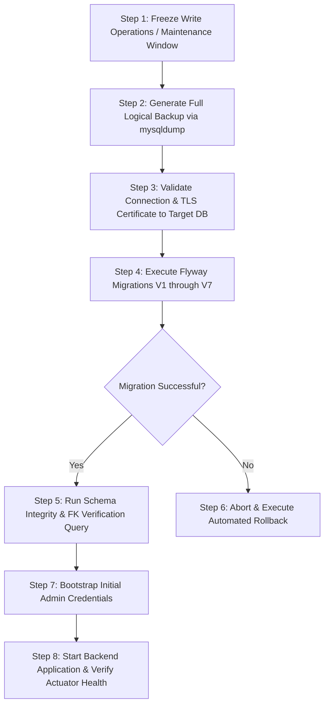

# BLUEBELLS SCHOOLING SYSTEM
## Module H — Production Database Migration & Schema Compatibility Plan

**Document Reference:** `BSS-DEP-002`  
**Institution:** Bluebells Schooling System, Hyderabad, Sindh, Pakistan  
**Author:** Ahmed Ali Khan <medlykhan@gmail.com>  
**Target RDBMS:** MySQL 8.0 Enterprise / TiDB Cloud Serverless  
**Status:** Approved for Production Execution  

---

### 1. Database Schema & Flyway Migration Audit

The Bluebells Schooling System database architecture is managed declaratively through versioned Flyway SQL migrations. An exhaustive audit was conducted across all existing migration scripts (`backend/src/main/resources/db/migration/`).

| Migration File | Description & Core Tables Managed | Target Version | Engine & Charset | Integrity Constraints |
| :--- | :--- | :--- | :--- | :--- |
| `V1__initial_schema.sql` | Core identity (`users`, `roles`, `user_roles`), institutional profiles, academic sessions, classes, sections, students, guardians, faculty, staff, daily attendance, fee heads, vouchers, payments, exams, gradebooks, notices. | V1.0 | `InnoDB`, `utf8mb4_unicode_ci` | Primary keys, composite unique indexes, cascading foreign keys. |
| `V2__lms_and_academic_core.sql` | Subject assignments, syllabus planning, digital homework assignments, student submission tracking, teacher evaluation & rubric scoring. | V2.0 | `InnoDB`, `utf8mb4_unicode_ci` | Foreign keys linking students, subjects, classes. |
| `V3__support_centre_and_ticketing.sql` | Role-isolated support tickets, parent-faculty messaging threads, internal administrative notes, SLA escalation timestamps. | V3.0 | `InnoDB`, `utf8mb4_unicode_ci` | Indexing on ticket numbers, creator IDs, assignee IDs. |
| `V4__school_assistant_and_knowledge_base.sql` | Institutional knowledge articles, category trees, AI assistant inquiry logs, feedback ratings, FAQ embeddings. | V4.0 | `InnoDB`, `utf8mb4_unicode_ci` | Fulltext indexing capability, category foreign keys. |
| `V5__digital_id_cards_and_verification.sql` | Barcode/QR verification tokens, issued ID card records, security hash verification logs, access control audit records. | V5.0 | `InnoDB`, `utf8mb4_unicode_ci` | Unique verification hash tokens, student reference foreign keys. |
| `V6__system_integrations_and_api_keys.sql` | Encrypted third-party API credentials, webhook endpoints, outbound event delivery logs, webhook retry queues. | V6.0 | `InnoDB`, `utf8mb4_unicode_ci` | Foreign keys to integration providers, payload status tracking. |
| `V7__advanced_analytics_and_student_development.sql` | Holistic student growth records, counseling notes, behavioral observations, developmental milestones, analytics materialized cache. | V7.0 | `InnoDB`, `utf8mb4_unicode_ci` | Strict role access constraints, indexed timestamp queries. |

#### Key Audit Verification Findings:
1. **Zero Stored Procedures or Triggers:** All migrations use clean ANSI-compliant SQL DDL and DML. No vendor-specific stored procedures, proprietary triggers, or custom functions exist in the repository, making migrations portable between standard MySQL 8.0 and distributed cloud engines.
2. **Standard Character Encoding:** Every table explicitly declares `ENGINE=InnoDB DEFAULT CHARSET=utf8mb4 COLLATE=utf8mb4_unicode_ci`. This guarantees full native support for regional languages (Urdu, Sindhi, Arabic script) in student names, parent correspondence, and fee voucher remarks.
3. **Hibernate DDL Validation:** In production (`application-prod.yml`), `spring.jpa.hibernate.ddl-auto: validate` is strictly enforced. Hibernate validates entity annotations against the database schema without attempting dynamic mutations at startup.

---

### 2. TiDB Cloud Serverless Compatibility Analysis

When evaluating TiDB Cloud Serverless (the primary free-tier MySQL-compatible cloud database), the following architectural considerations were audited:

#### 2.1 Character Set & Collation Compatibility
- TiDB natively supports `utf8mb4` and `utf8mb4_unicode_ci` (and `utf8mb4_bin`).
- All `VARCHAR` and `TEXT` fields in `V1`–`V7` execute without syntax alteration or character translation loss.

#### 2.2 Foreign Key Constraint Enforcement
- *Historical Context:* Prior to TiDB v6.6, foreign key constraints were parsed but not enforced by default.
- *Production State:* Modern TiDB Serverless (running TiDB v7.1+) fully enforces foreign key referential integrity.
- *Mandatory Pre-Flight Execution:* When provisioning a new TiDB database, the connection initialization must execute:
  ```sql
  SET @@global.foreign_key_checks = ON;
  ```

#### 2.3 Distributed Auto-Increment Behavior
- *Behavior:* TiDB distributes ID allocation across multiple TiDB server nodes using cached ID ranges. As a result, auto-increment IDs are guaranteed to be unique and strictly monotonic per connection, but may show non-consecutive numbering across concurrent distributed connections.
- *Impact on Bluebells:* **Zero adverse impact.** All Bluebells JPA entities use standard `@GeneratedValue(strategy = GenerationType.IDENTITY)` surrogate keys. The application business logic never assumes sequential primary keys without gaps. Institutional serial numbers (such as Student Enrollment Numbers `BSS-2026-0001` or Fee Voucher Codes `VCH-202611-0001`) are generated via dedicated serial formatters rather than raw table primary key IDs.

#### 2.4 Transaction Isolation
- TiDB uses **Snapshot Isolation (SI)** (conceptually identical to MySQL's Repeatable Read isolation level for non-locking reads).
- Pessimistic transactions are enabled by default in modern TiDB versions (`pessimistic-txn.default = true`), matching standard MySQL row-locking behavior for `@Transactional` Spring Boot methods.

---

### 3. Pre-Migration Verification & Checksum Baseline

Before executing migrations in any staging or production environment, the database administrator must perform the following pre-flight checks:

```bash
# 1. Verify Connectivity and Permissions
mysql -h $DB_HOST -P $DB_PORT -u $DB_USER -p$DB_PASSWORD -e "SELECT VERSION(), CURRENT_USER();"

# 2. Verify Character Set and Collation Configuration
mysql -h $DB_HOST -P $DB_PORT -u $DB_USER -p$DB_PASSWORD $DB_NAME -e "
  SHOW VARIABLES LIKE 'character_set_database';
  SHOW VARIABLES LIKE 'collation_database';
"

# 3. Verify Foreign Key Checks are Enabled
mysql -h $DB_HOST -P $DB_PORT -u $DB_USER -p$DB_PASSWORD $DB_NAME -e "
  SHOW VARIABLES LIKE 'foreign_key_checks';
"
```

#### Flyway Migration Checksum Baseline Table
The following SHA-256 baseline checksums must be recorded in the `flyway_schema_history` table:

```sql
SELECT installed_rank, version, description, type, script, checksum, installed_on, success 
FROM flyway_schema_history 
ORDER BY installed_rank;
```

If a checksum mismatch occurs due to line-ending variations (`CRLF` vs `LF` between Windows and Linux/macOS), execute Flyway repair before proceeding:
```bash
mvn flyway:repair -Dflyway.configFiles=backend/src/main/resources/application-prod.yml
```

---

### 4. Step-by-Step Migration Execution Procedure



#### Detailed Execution Commands:

1. **Pre-Migration Full Dump:**
   ```bash
   mysqldump -h $DB_HOST -P $DB_PORT -u $DB_USER -p$DB_PASSWORD \
     --single-transaction \
     --quick \
     --routines \
     --triggers \
     --default-character-set=utf8mb4 \
     $DB_NAME > /backups/bluebells_pre_migration_$(date +%Y%m%d_%H%M%S).sql
   ```

2. **Automated Spring Boot Migration:**  
   During backend startup with `spring.profiles.active=prod`, Spring Boot automatically initializes Flyway:
   ```yaml
   spring:
     flyway:
       enabled: true
       baseline-on-migrate: true
       locations: classpath:db/migration
   ```

3. **Post-Migration Verification Query:**
   ```sql
   -- Verify all 7 migrations applied successfully
   SELECT COUNT(*) AS total_migrations_applied 
   FROM flyway_schema_history 
   WHERE success = 1;
   -- Expected count: 7
   ```

---

### 5. Rollback and Disaster Recovery Plan

If a migration fails due to network termination, constraint violation, or hardware fault:

1. **Immediate Action:** Stop the backend service immediately to prevent partial schema corruption:
   ```bash
   docker stop bluebells_prod_backend || pkill -f bluebells-lms
   ```
2. **Inspect Migration Failure Log:**
   ```sql
   SELECT * FROM flyway_schema_history WHERE success = 0;
   ```
3. **Schema Rollback from Logical Dump:**
   ```bash
   # Re-create clean database instance
   mysql -h $DB_HOST -P $DB_PORT -u $DB_USER -p$DB_PASSWORD -e "
     DROP DATABASE IF EXISTS $DB_NAME;
     CREATE DATABASE $DB_NAME CHARACTER SET utf8mb4 COLLATE utf8mb4_unicode_ci;
   "
   # Restore clean pre-migration dump
   mysql -h $DB_HOST -P $DB_PORT -u $DB_USER -p$DB_PASSWORD $DB_NAME < /backups/bluebells_pre_migration_latest.sql
   ```
4. **Flyway Schema History Repair:**
   ```bash
   mvn flyway:repair
   ```
5. **Root-Cause Analysis & Fix:** Correct the underlying migration SQL, test against local Docker MySQL 8 instance, and re-run.
