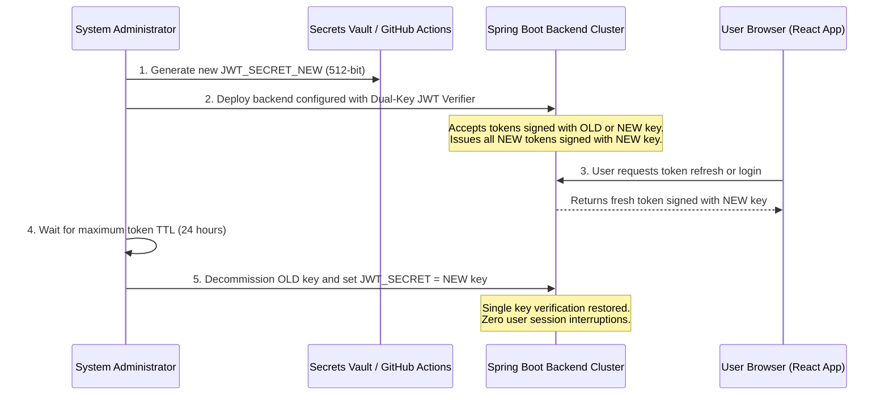

# BLUEBELLS SCHOOLING SYSTEM
## Module H — Production Environment Configuration & Secret Management Runbook

**Document Reference:** `BSS-DEP-003`  
**Institution:** Bluebells Schooling System, Hyderabad, Sindh, Pakistan  
**Author:** Ahmed Ali Khan <medlykhan@gmail.com>  
**Status:** Approved Configuration Standard  

---

### 1. Environment Variable Catalog

This catalog documents all operational environment variables required across the Bluebells Schooling System infrastructure.

#### 1.1 Backend Application & Security Configuration

| Variable Name | Required? | Default Value | Sensitivity | Format / Constraints | Operational Purpose |
| :--- | :--- | :--- | :--- | :--- | :--- |
| `PORT` | Optional | `8080` | Low | Numeric (1024–65535) | HTTP port bound by the container runtime. Render/Koyeb inject this dynamically. |
| `SPRING_PROFILES_ACTIVE` | **Required** | `prod` | Low | String (`prod`, `staging`) | Activates production profile with strict DDL validation and secure actuator defaults. |
| `JWT_SECRET` | **MANDATORY** | *None* | **CRITICAL** | Minimum 512 bits / 64 Base64 chars | Secret key for signing and validating HMAC-SHA512 JSON Web Tokens. Fail-safe aborts startup if omitted. |
| `INITIAL_ADMIN_USERNAME` | Optional | `admin` | Medium | Alphanumeric (3–30 chars) | Username for default platform administrator account created during first-time bootstrap. |
| `INITIAL_ADMIN_PASSWORD` | **Required (Prod)** | *None* | **HIGH** | Minimum 16 characters | Password for initial administrator. If omitted in prod, a secure 24-char password is auto-generated. |
| `INITIAL_ADMIN_EMAIL` | Optional | `admin@bluebells.edu.pk` | Medium | RFC 5322 Email | Primary institutional email for administrative alerts and recovery. |
| `STORAGE_DIR` | Optional | `/var/bluebells/storage` | Low | Absolute POSIX file path | Local filesystem directory for storing uploaded student photos, fee receipts, and ID card assets. |
| `CORS_ALLOWED_ORIGINS` | **Required** | *See default* | Medium | Comma-separated URLs | Allowed Cross-Origin Resource Sharing frontend domains (e.g. `https://portal.bluebells.edu.pk`). |
| `JAVA_TOOL_OPTIONS` | Optional | *-XX:MaxRAMPercentage=75.0* | Low | JVM flag string | Memory limit controls and G1GC garbage collection configuration for container environments. |

---

#### 1.2 Relational Database Connection Configuration

| Variable Name | Required? | Default Value | Sensitivity | Format / Constraints | Operational Purpose |
| :--- | :--- | :--- | :--- | :--- | :--- |
| `DB_HOST` | **Required** | `localhost` | Low | Hostname or IP address | Hostname of the MySQL 8 / TiDB Cloud instance. |
| `DB_PORT` | Optional | `3306` | Low | Numeric (default 3306 or 4000) | Port number (3306 for MySQL, 4000 for TiDB Cloud). |
| `DB_NAME` | **Required** | `bluebells_school_db` | Low | MySQL identifier | Name of the institutional database catalog. |
| `DB_USER` | **Required** | `bluebells_user` | Medium | Alphanumeric string | Database user account with limited DDL/DML permissions. |
| `DB_PASSWORD` | **MANDATORY** | *None* | **CRITICAL** | Minimum 16 characters | Secure password for database user account. |
| `SPRING_DATASOURCE_URL` | Optional | *Computed from parts* | Medium | JDBC URL string | Full JDBC connection string (alternative to individual host/port variables). |

---

#### 1.3 Frontend Single-Page Application (React / Vite)

| Variable Name | Required? | Default Value | Sensitivity | Format / Constraints | Operational Purpose |
| :--- | :--- | :--- | :--- | :--- | :--- |
| `VITE_API_URL` | **Required (Build)** | `/api/v1` | Low | HTTPS URL without trailing slash | Target REST API endpoint URL baked into the client bundle during `npm run build`. |

> [!CAUTION]
> In Vite, all environment variables prefixed with `VITE_` are embedded into the client-side JavaScript bundle and are publicly inspectable by any browser. **NEVER prefix database passwords, JWT secrets, or administrative credentials with `VITE_`.**

---

### 2. Cryptographic Secret Generation Standards

Every production secret must be generated using an entropy-tested cryptographic pseudorandom number generator (CSPRNG):

```bash
# 1. Generate 512-bit JWT Signing Secret (HMAC-SHA512)
openssl rand -base64 64

# 2. Generate High-Entropy Database Password (24 characters alphanumeric)
openssl rand -base64 24 | tr -dc 'A-Za-z0-9!@#%^&*' | head -c 24; echo

# 3. Generate Secure Initial Administrator Password (24 characters)
openssl rand -base64 24 | tr -dc 'A-Za-z0-9!@#%^&*' | head -c 24; echo

# 4. Generate Internal Service-to-Service API Key
openssl rand -hex 32
```

---

### 3. Zero-Downtime Secret Rotation Runbook

#### 3.1 JWT Secret Key Rotation Procedure
To rotate a compromised or scheduled JWT secret without disrupting active teacher, parent, or administrator sessions:



#### 3.2 Database Credential Rotation
1. **Create Secondary User:** Create a secondary database user on MySQL/TiDB:
   ```sql
   CREATE USER 'bluebells_user_v2'@'%' IDENTIFIED BY 'FreshHighEntropyPassword2026!';
   GRANT SELECT, INSERT, UPDATE, DELETE, CREATE, INDEX, ALTER, REFERENCES ON bluebells_school_db.* TO 'bluebells_user_v2'@'%';
   FLUSH PRIVILEGES;
   ```
2. **Update Application Configuration:** Update `DB_USER` and `DB_PASSWORD` in the PaaS dashboard or environment file.
3. **Graceful Rolling Restart:** Deploy the update with rolling restart. Active connections on the old user finish gracefully.
4. **Decommission Old User:** After verifying all nodes are connected via `bluebells_user_v2`:
   ```sql
   DROP USER 'bluebells_user_v1'@'%';
   ```

---

### 4. Production Environment Validation Script

Execute this bash verification script before bringing public traffic onto the cluster:

```bash
#!/usr/bin/env bash
set -euo pipefail

echo "=== Bluebells Production Environment Verification ==="

# Check critical variables
check_var() {
  local var_name="$1"
  if [ -z "${!var_name:-}" ]; then
    echo "[-] FAILED: Environment variable '$var_name' is missing or empty!"
    exit 1
  else
    echo "[+] PASSED: '$var_name' is defined."
  fi
}

check_var "JWT_SECRET"
check_var "DB_HOST"
check_var "DB_NAME"
check_var "DB_USER"
check_var "DB_PASSWORD"
check_var "CORS_ALLOWED_ORIGINS"

# Verify JWT_SECRET length (must be >= 64 characters)
if [ "${#JWT_SECRET}" -lt 64 ]; then
  echo "[-] FAILED: JWT_SECRET length is only ${#JWT_SECRET} chars. Minimum 64 characters required for HMAC-SHA512!"
  exit 1
fi
echo "[+] PASSED: JWT_SECRET meets 512-bit entropy requirement."

echo "=== Environment Configuration Fully Verified for Production ==="
```
