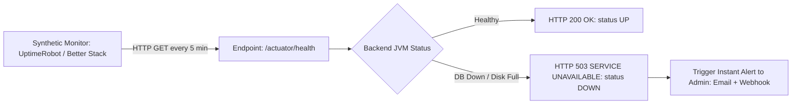

# BLUEBELLS SCHOOLING SYSTEM
## Module H — Production Monitoring, Health Probes & Alerting Runbook

**Document Reference:** `BSS-DEP-006`  
**Institution:** Bluebells Schooling System, Hyderabad, Sindh, Pakistan  
**Author:** Ahmed Ali Khan <medlykhan@gmail.com>  
**Status:** Approved for Operations  

---

### 1. Health Probe Architecture

Operational observability for the Bluebells Schooling System backend is delivered through standardized Spring Boot 3 Actuator health endpoints.



#### 1.1 Endpoint Specifications

| Endpoint Path | Access Level | Response Format | Purpose |
| :--- | :--- | :--- | :--- |
| `/actuator/health` | **Public** | `{"status":"UP"}` | Primary liveness and readiness probe for load balancers, Docker healthchecks, and external uptime monitors. |
| `/actuator/health/liveness` | **Public** | `{"status":"UP"}` | Kubernetes / container runtime check determining if JVM needs container restart. |
| `/actuator/health/readiness` | **Public** | `{"status":"UP"}` | Determines if database connection pool is active and ready to accept HTTP traffic. |
| `/actuator/metrics` | **SUPER_ADMIN Only** | Detailed JSON | JVM heap consumption, garbage collection pauses, HTTP request latency percentiles. |

#### 1.2 Information Leakage Prevention
In production (`application-prod.yml`), `management.endpoint.health.show-details: never` is strictly enforced.
- **Development Response (Unsafe for Public):** Leaks database URLs, Hikari connection pool free counts, disk mount paths, and disk free space in bytes.
- **Production Response (Hardened):** Emits only `{"status":"UP"}` or `{"status":"DOWN"}` with HTTP 200 or HTTP 503 status codes.

---

### 2. Free-Tier Keep-Alive Pinger Reality Check

Many development teams attempt to prevent free-tier container sleep (such as Render's 15-minute inactivity spin-down) by configuring an external cron ping (e.g. UptimeRobot hitting `/actuator/health` every 10 minutes).

A rigorous architectural evaluation reveals critical risks and realities:

#### 2.1 The 750-Hour Free Allowance Trap
- **The Constraint:** Render grants **750 free instance hours per calendar month** shared across all free services on an account.
- **The Math:** A service kept awake 24 hours a day for a 31-day month consumes:
  $$\text{Hours} = 24 \times 31 = 744\text{ hours}$$
- **The Failure Mode:** If you have even a single secondary test service, staging branch, or minor background task, your account exhausts its 750-hour budget on day 28. **Render shuts down all free services on the account until the 1st of the next month.**

#### 2.2 Cold Start Reality on Bluebells User Experience
- **Cold Start Duration:** 45 to 60 seconds from cold slumber to accepting traffic.
- **Educational Impact:**
  - Morning School Hours (07:30 to 08:30 PKT): Attendance marking by 40 teachers simultaneously. If the server is cold, morning roll call fails.
  - Fee Payment Windows: Parents opening fee payment links on mobile browsers experience connection timeouts or blank screens, creating support panic.
- **Policy Compliance:** Automated pingers designed specifically to circumvent idle spin-down violate the Terms of Service of several free PaaS providers and can lead to automated IP rate-limiting or account suspension.

#### 2.3 Architectural Recommendation:
- **For Non-Critical Staging / Testing:** Accept the 15-minute sleep policy and educate testers on the initial 50-second cold-start delay.
- **For Production Operations:** Do **not** rely on keep-alive hacks. Deploy the production stack on an always-on server (such as Oracle Cloud Always Free Ampere A1 or a dedicated $4–$6/month VPS) that runs 24/7/365 without sleep cycles.

---

### 3. External Monitoring Configuration

#### 3.1 Recommended Free Monitoring Providers

| Provider | Free Monitoring Tier | Check Interval | Alerting Channels | Recommended Usage |
| :--- | :--- | :--- | :--- | :--- |
| **UptimeRobot** | 50 monitors free | 5 minutes | Email, Webhook | Primary external HTTP liveness probe |
| **Better Stack (Better Uptime)** | 10 monitors free | 3 minutes | Email, SMS (limited), Slack | Secondary probe with rich incident pages |
| **Cronitor** | 5 cron monitors free | Real-time | Email, Webhook | Backup monitoring for scheduled nightly dumps |

#### 3.2 UptimeRobot Monitor Setup Specification

1. **Monitor Type:** `HTTP(s)`
2. **Friendly Name:** `Bluebells Backend Production Health`
3. **URL / IP:** `https://api.bluebells.edu.pk/actuator/health` (or `https://<render-url>/actuator/health`)
4. **Monitoring Interval:** `5 minutes`
5. **Monitor Timeout:** `30 seconds`
6. **HTTP Method:** `HEAD` or `GET`
7. **Expected Status Code:** `200`
8. **Keyword Monitoring (Optional):** Alert if response does not contain `"UP"`.

---

### 4. Alert Escalation & Notification Policy

```
+-------------------------------------------------------------------------------+
| INCIDENT LEVEL 1: Transitory Network Flake (Single 5-minute failure)           |
| - Action: UptimeRobot retries after 60 seconds.                               |
| - Notification: None (suppresses false alarm fatigue).                        |
+-------------------------------------------------------------------------------+
                                    |
                    Failure persists for 2 consecutive checks
                                    v
+-------------------------------------------------------------------------------+
| INCIDENT LEVEL 2: Confirmed Outage (Downtime >= 6 minutes)                    |
| - Action: Trigger automated high-priority alert.                              |
| - Recipient 1: Institutional Email (admin@bluebells.edu.pk).                  |
| - Recipient 2: Operations Incident Webhook (Discord / Slack channel).         |
| - Expected Response: Administrator investigates container crash logs.         |
+-------------------------------------------------------------------------------+
```

#### Incident Discord / Slack Webhook Payload Template:
```json
{
  "username": "Bluebells Health Bot",
  "avatar_url": "https://portal.bluebells.edu.pk/assets/crest.png",
  "content": "🚨 **CRITICAL ALERT: Production Service Down**\n- **Service:** Bluebells School Backend API\n- **Endpoint:** `/actuator/health`\n- **Timestamp:** Asia/Karachi (PKT)\n- **Action Required:** Check container logs and database connectivity immediately."
}
```
