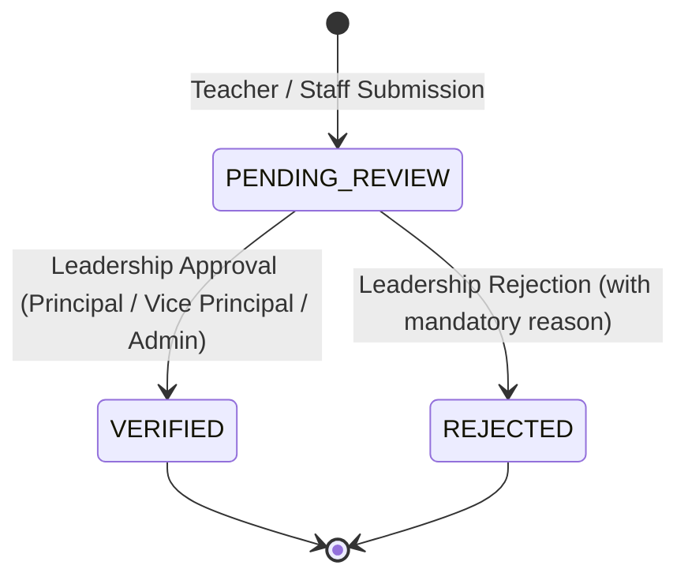

# Bluebells Student Development — Security & Verification Lifecycle Audit

**Module**: Student Holistic Development & Growth Portfolio  
**Backend**: `StudentDevelopmentController.java`, `StudentDevelopmentService.java`, `StudentDevelopmentRecord.java`  
**Frontend**: `StudentDevelopmentPage.tsx`  
**Auditor**: Ahmed Ali Khan <medlykhan@gmail.com>  
**Date**: November 2026  

---

## 1. Module Overview & Lifecycle Architecture

The Student Development module tracks student achievements, sports championships, Olympiad participation, co-curricular arts, project work, positive behaviour commendations, and teacher appreciation beyond standard academic exam marks.

### Formal Approval Lifecycle

---

## 2. Security Controls & Audit Findings

### 2.1. Verification Privilege Separation
- **Vulnerability Prior to Audit**: Previously, teacher submissions were automatically marked as `VERIFIED`, allowing unvetted or inaccurate achievements to enter official student portfolios without leadership review.
- **Remediation**:
  - `StudentDevelopmentService.createRecord`: When submitted by teachers without executive leadership roles, the record status defaults strictly to `PENDING_REVIEW`.
  - Dedicated leadership endpoints:
    - `PATCH /api/v1/development/records/{id}/verify` (Restricted to `SUPER_ADMIN`, `SCHOOL_ADMIN`, `PRINCIPAL`, `VICE_PRINCIPAL`)
    - `PATCH /api/v1/development/records/{id}/reject` (Restricted to Leadership; requires rejection reason)

### 2.2. Secure Authenticated Evidence Retrieval
- **Vulnerability Prior to Audit**: Evidence files (certificates, photos, letters) had no authenticated access control, risking arbitrary file disclosure or unauthenticated hotlinking.
- **Remediation**:
  - Implemented `GET /api/v1/development/records/{id}/evidence`.
  - Enforced ownership check: Parents can only download evidence for their linked children; students can only download their own evidence; staff and leadership can access all evidence.
  - Stored files outside the public web root using unique sanitized filenames.

### 2.3. Parent IDOR & Family Privacy
- **Verification**: `StudentDevelopmentTest.testParentCannotViewOtherStudentAchievements` verifies that Parent A attempting to view records for Student B receives `403 Access Denied: You can only view achievements for your registered children.`

---

## 3. Automated Test Verification

All 4 test cases in `StudentDevelopmentTest.java` pass cleanly:
1. `testParentCannotViewOtherStudentAchievements`: Confirms IDOR protection (HTTP 403).
2. `testTeacherCanCreateAchievement`: Confirms teacher creation in `PENDING_REVIEW` status.
3. `testLeadershipCanVerifyAchievement`: Confirms leadership transition to `VERIFIED`.
4. `testStudentCanViewOwnAchievements`: Confirms student portfolio visibility.
