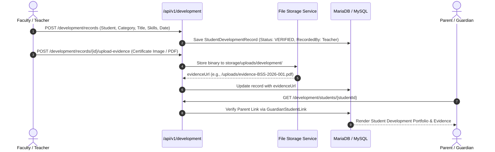

# Bluebells Schooling System — Student Development Centre Guide

**Document Reference:** `BSS-SDC-2026-V1`  
**Campus:** Adjacent Autobahn Road, Next to VIP Garden, Unit 2, Latifabad, Hyderabad, Sindh  
**Leadership:** Academic Principal Huma Arif | Vice Principal Hana Khan | Senior Faculty Coordinator Sir Ahmed Khan  
**Classification:** Student Development & Holistic Portfolio Framework  

---

## 1. Vision & Educational Philosophy

Academic examinations represent only one dimension of a student's potential. The **Student Development Centre** at Bluebells Schooling System provides a permanent, verified institutional portfolio documenting character, leadership, athleticism, co-curricular arts, and civics.

Every recorded milestone is authenticated by faculty or school administration, backed by documentary or photographic evidence, and preserved throughout the student's enrollment at Bluebells.

---

## 2. Development Categories & Evaluation Rubrics

The system organizes non-academic growth into ten standardized categories:

| Category Code | Domain Title | Typical Milestones & Evidence |
| :--- | :--- | :--- |
| `ACADEMIC_ACHIEVEMENT` | Academic Distinction | Science Olympiad medal, Mathematics Kangaroo distinction, essay contest |
| `SPORTS` | Sports & Athletics | Inter-School Football Championship, Cricket captaincy, track & field |
| `COMPETITION` | Competitive Events | District debates, spelling bee, regional robotics challenge |
| `AWARD` | Institutional Honors | Principal's Honor Roll, Student of the Month, Annual Sportsmanship Cup |
| `CERTIFICATE` | External Certifications | Red Cross first-aid, environmental camp certificate, coding bootcamp |
| `CO_CURRICULAR` | Arts & Co-Curricular | Annual school play lead role, calligraphy competition, choir performance |
| `PROJECT` | STEM & Social Projects | Solar-powered rover model, campus recycling drive, robotics build |
| `POSITIVE_BEHAVIOUR` | Civics & Conduct | Exemplary peer mentorship, integrity commendation, playground mediator |
| `TEACHER_APPRECIATION` | Faculty Commendations | Written appreciation notes from class teacher, mentor recognition |
| `SKILL_MILESTONE` | Competency Milestones | Public speaking fluency, collaborative team problem-solving |

---

## 3. Achievement Recording Workflow (Faculty & Administration)

### Steps to Record an Achievement:
1. Log in to the Bluebells Portal with authorized faculty credentials (`ROLE_TEACHER`, `ROLE_PRINCIPAL`, or `ROLE_SCHOOL_ADMIN`).
2. Navigate to **Student Growth & Identity → Student Development**.
3. Click **"Record Achievement / Milestone"**.
4. Complete the required form fields:
   - **Student**: Select student by name or admission number.
   - **Category**: Select appropriate category from the rubric.
   - **Title**: Descriptive milestone title (e.g., "Hyderabad Inter-School Football Championship Gold Medal").
   - **Level**: `INTRA_SCHOOL`, `INTER_SCHOOL`, `DISTRICT`, `DIVISION`, `PROVINCIAL`, `NATIONAL`, or `INTERNATIONAL`.
   - **Position / Award**: E.g., "Gold Medalist", "1st Runner-up", "Best Speaker".
   - **Skills Acquired**: Comma-separated list (e.g., "Team Leadership, Stamina, Tactical Play").
   - **Teacher Appreciation Note**: Commendation from coach or class mentor.
5. Upload supporting evidence (scanned certificate, event photograph, or trophy letter).
6. Click **Save Milestone**. The record is permanently watermarked with the creator's identity and timestamp.

---

## 4. Privacy & Access Control Guardrails

The Student Development module enforces strict privacy boundaries:
1. **Parent Ward Isolation**: Parents can **only view** records belonging to their legally linked children. Any attempt by a parent to query development records for an unlinked student returns an immediate HTTP `403 Forbidden` (`API Exception: Access Denied: You can only view achievements for your registered children.`).
2. **Student Self-View**: Students can view their personal development timeline and download their verified certificates, but are barred from creating or modifying records.
3. **Immutable Audit Trail**: Development records cannot be silently overwritten; all deletions and updates are restricted to authorized school administrators.

---

## 5. API Reference

| Endpoint | Method | Permitted Roles | Description |
| :--- | :--- | :--- | :--- |
| `/api/v1/development/students/{studentId}` | `GET` | Staff, Parent (Linked), Student (Self) | Retrieve verified student achievements portfolio |
| `/api/v1/development/records` | `POST` | Super Admin, School Admin, Principal, VP, Teacher | Record new achievement or milestone |
| `/api/v1/development/records/{id}/upload-evidence` | `POST` | Super Admin, School Admin, Principal, VP, Teacher | Upload certificate scan or photo evidence |
| `/api/v1/development/records/{id}` | `DELETE`| Super Admin, School Admin, Principal | Remove erroneous development record |

*Authorized by Academic Principal Huma Arif & Vice Principal Hana Khan.*
