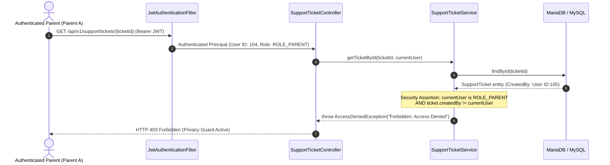
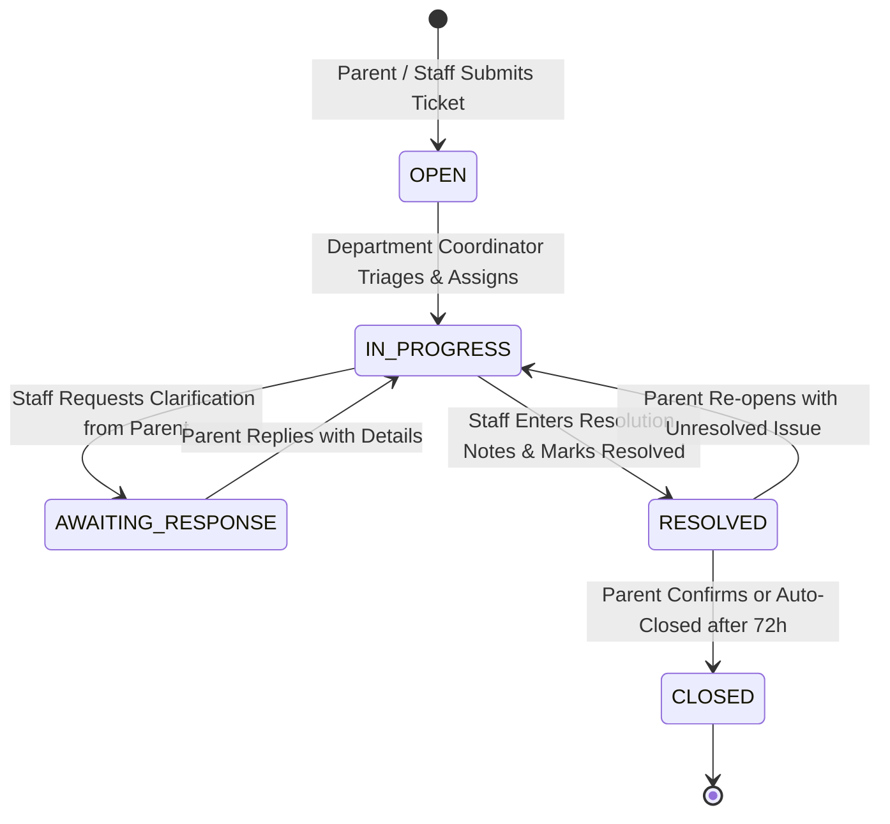

# Bluebells Schooling System — Support & Complaint Centre Guide

**Document Reference:** `BSS-SUP-2026-V1`  
**Campus:** Adjacent Autobahn Road, Next to VIP Garden, Unit 2, Latifabad, Hyderabad, Sindh  
**Leadership:** Academic Principal Huma Arif | Vice Principal Hana Khan  
**Classification:** Institutional Helpdesk, Case Management & Parent Privacy Protocol  

---

## 1. Executive Overview & Purpose

The **Support & Complaint Centre** serves as the central omnichannel communication bridge between parents, guardians, faculty, and administrative departments at Bluebells Schooling System.

Designed to eliminate unrecorded informal messaging and physical paperwork, the system provides:
1. **End-to-End Case Tracking**: Every inquiry, feedback, or grievance receives an immutable ticket identifier (e.g., `TKT-2026-0001`) with complete timestamped audit logging.
2. **Deterministic Role-Based Privacy**: Parents and guardians are strictly sandboxed to their own submitted tickets. Under no circumstances can any parent view, inspect, or discover tickets belonging to other families.
3. **Staff Internal Collaboration Channel**: School leadership and faculty can record confidential internal notes on tickets (e.g., clearance checks, disciplinary background, or fee adjustments) that are cryptographically and logically excluded from the parent portal.
4. **Multi-Department Workflow Routing**: Direct dispatch to Academic, Accounts/Fee, Transport, Administration, and Technical support desks with designated Service Level Agreements (SLAs).

---

## 2. Ticket Categories & Department Routing Matrix

Tickets are classified into seven official institutional domains, automatically notifying the respective department coordinators:

| Category Code | Domain Title | Target Department | Primary Responders & Stakeholders | Standard SLA |
| :--- | :--- | :--- | :--- | :--- |
| `ACADEMIC` | Academic & Curriculum | Academic Coordination Desk | Senior Faculty Coordinator Sir Ahmed Khan, Subject Lead | 24 Hours |
| `FACULTY` | Faculty & Teaching Feedback | Academic Principal's Office | Academic Principal Huma Arif, Vice Principal Hana Khan | 24 Hours |
| `FEE` | Fee, Billing & Challans | Accounts & Finance Division | Chief Accountant, Askari Bank Liaison Desk | 12 Hours |
| `TRANSPORT` | School Transport & Van Fleet | Transport & Fleet Dispatch | Fleet Manager, Campus Security Supervisor | 6 Hours |
| `ADMINISTRATIVE` | General Administration & Records | Registrar & Admissions Office | Administrative Officer, Front Desk Registrar | 24 Hours |
| `TECHNICAL` | Portal & Technical Support | IT & Systems Engineering | LMS Administrator, Database Engineer | 12 Hours |
| `SUGGESTION` | Parent Suggestions & Feedback | School Leadership Council | Vice Principal Hana Khan | 48 Hours |

---

## 3. Priority Levels & Service Level Agreements (SLAs)

Every submitted ticket is tagged with an operational priority level determining its escalation path:

| Priority | Criteria & Typical Scenarios | First Response SLA | Target Resolution SLA | Escalation Target |
| :--- | :--- | :--- | :--- | :--- |
| `URGENT` | Safety concerns, critical transport delays, urgent medical updates, fee deadline lockouts | $< 2\text{ Hours}$ | $< 6\text{ Hours}$ | Vice Principal & Principal |
| `HIGH` | Examination schedule issues, report card grading disputes, fee challan discrepancies | $< 6\text{ Hours}$ | $< 24\text{ Hours}$ | Department Head |
| `MEDIUM` | Syllabus pacing inquiries, booklist clarification, portal navigation assistance | $< 12\text{ Hours}$ | $< 48\text{ Hours}$ | Assigned Coordinator |
| `LOW` | General suggestions, document request inquiries (character certs), co-curricular dates | $< 24\text{ Hours}$ | $< 72\text{ Hours}$ | Front Desk Staff |

---

## 4. Strict Parent Privacy & Data Isolation Architecture

> [!IMPORTANT]
> **Strict Parent Privacy Guarantee**:
> In compliance with institutional child protection policies and family privacy safeguards, parents and guardians can **only** view tickets created by their own authenticated user accounts.
> 
> Attempting to access another parent's ticket (even by guessing or sequentially enumerating ticket IDs) triggers an immediate HTTP `403 Forbidden` response and an automated security audit entry.

### Architectural Privacy Enforcement Flow:



---

## 5. Ticket Status Lifecycle & Resolution Workflow

Tickets transition through five deterministic status states:



### State Definitions:
1. `OPEN`: Newly filed ticket awaiting initial triage and department assignment.
2. `IN_PROGRESS`: Assigned to a coordinator or faculty member; actively being addressed.
3. `AWAITING_RESPONSE`: Staff has posted a public response requesting additional student details or receipts from the parent.
4. `RESOLVED`: The issue has been formally addressed. Mandatory `resolutionNotes` are recorded by staff explaining the exact resolution provided.
5. `CLOSED`: Case concluded and archived for historical compliance and service metrics.

---

## 6. Staff Internal Notes System

School staff frequently require internal discussion before presenting an official resolution to parents.

### How Internal Notes Work:
- **Staff Toggle**: Staff with `ROLE_TEACHER`, `ROLE_PRINCIPAL`, `ROLE_VICE_PRINCIPAL`, or `ROLE_SUPER_ADMIN` can set `isInternalNote = true` when posting a message.
- **Visual Distinctiveness**: Internal notes are displayed in amber/gold with an alert badge: `STAFF INTERNAL NOTE — INVISIBLE TO PARENT/STUDENT`.
- **Backend Data Stripping**: The backend DTO transformer inspects the requesting principal:
  ```java
  // In SupportTicketService.java
  boolean isStaff = currentUser.getRoles().stream()
      .anyMatch(r -> Set.of("ROLE_SUPER_ADMIN", "ROLE_SCHOOL_ADMIN", 
                            "ROLE_PRINCIPAL", "ROLE_VICE_PRINCIPAL", "ROLE_TEACHER").contains(r.getName()));

  List<TicketMessageDto> messageDtos = ticket.getMessages().stream()
      .filter(m -> isStaff || !m.isInternalNote()) // Parents strictly excluded from internal notes
      .map(this::toDto)
      .toList();
  ```
- **Automated Verification**: Validated 100% in `SupportTicketPrivacyTest.testStaffInternalNotesHiddenFromParent`.

---

## 7. Escalation Management & Multi-Tier Routing

When a ticket approaches its SLA limit or involves serious conduct or financial anomalies, it follows an automated escalation hierarchy:

```
+------------------------------------------------------------------+
| TIER 1: Classroom Teacher / Front Desk Assistant                 |
| Action: Acknowledges inquiry within 2 hours, resolves routine    |
|         homework, syllabus, and document requests.               |
+---------------------------------+--------------------------------+
                                  | SLA Exceeded (> 24h) or High Priority
                                  v
+------------------------------------------------------------------+
| TIER 2: Department Head / Senior Faculty Coordinator             |
| Leads:  Sir Ahmed Khan (Academics) | Accounts Lead (Finance)     |
| Action: Coordinates cross-functional review, issues ledger credit|
|         or arranges formal parent-teacher conference.            |
+---------------------------------+--------------------------------+
                                  | SLA Exceeded (> 48h) or Urgent Conduct
                                  v
+------------------------------------------------------------------+
| TIER 3: Institutional Executive Leadership                       |
| Leads:  Academic Principal Huma Arif | Vice Principal Hana Khan  |
| Action: Direct executive intervention, administrative policy     |
|         exception, and formal written board notification.        |
+------------------------------------------------------------------+
```

---

## 8. API Specification & Security Matrix

All endpoints require standard JWT Bearer authorization:

| Method | Endpoint | Authorized Roles | Functionality |
| :--- | :--- | :--- | :--- |
| `POST` | `/api/v1/support/tickets` | Any Authenticated User | Create ticket (Parents automatically assigned to own user) |
| `GET` | `/api/v1/support/tickets` | Any Authenticated User | List tickets (Parents see only own tickets; Staff see all) |
| `GET` | `/api/v1/support/tickets/{id}` | Author, Assigned Staff, Leadership | View ticket details and sanitized message history |
| `POST` | `/api/v1/support/tickets/{id}/messages` | Author, Assigned Staff, Leadership | Post public reply or confidential staff internal note |
| `PATCH`| `/api/v1/support/tickets/{id}/status` | Staff, Leadership | Update status (`IN_PROGRESS`, `RESOLVED`, `CLOSED`) with notes |
| `PATCH`| `/api/v1/support/tickets/{id}/assign` | Staff, Leadership | Reassign ticket to specific staff member or department |

---

## 9. Step-by-Step User Instructions

### A. Submitting a Ticket (Parent / Guardian):
1. Navigate to **Support & Helpdesk → Support Centre** from the sidebar navigation.
2. Click **+ New Support Ticket**.
3. Select the appropriate **Category** (e.g., `Fee, Billing & Challans`).
4. Select the **Priority** and related student (e.g., `Ali Khan`).
5. Provide a clear **Subject** and detailed description of the inquiry.
6. Click **Submit Ticket**. The ticket appears immediately in your personal queue with status `OPEN`.

### B. Handling Tickets (Faculty & Administrative Staff):
1. Navigate to **Support Centre**; view the comprehensive institution-wide ticket queue.
2. Filter by status (`OPEN`), department, or priority (`URGENT`).
3. Click a ticket to review conversation history and parent details.
4. To confer privately with a colleague: Toggle **Internal Note (Staff Only)**, type findings, and click **Post Internal Note**.
5. To reply to the parent: Toggle off internal note, draft the formal response, and click **Send Reply**.
6. When resolved: Click **Resolve Ticket**, input mandatory resolution summary notes, and click **Confirm Resolution**.
